# ACM avec R

Ceci est un document qui contient le code utilisé pour réaliser des
sorties graphiques d’ACM. Pour les phases préalables, où il faut choisir
les variables pertinentes de l’analyse et essayer un grand nombre de
combinaison de variable,  
on aura plutôt recours à `Factoshiny::MCAshiny()` qui permet d’explorer
rapidement les différentes analyses possibles à partir d’un même jeu de
données. De manière similaire, `explor::explor()` fonctionne très bien
pour rapidement explorer un résultat.

Le code présenté ici et dans le packages interviennent en général à une
phase ultérieure, où l’on cherche à manipuler le résultat de l’analyse
pour produire des graphiques, des tableaux, etc.

Le code ci-dessous utilise un style “tidyverse” qui peut être exotique
pour certains, notamment dans l’usage du “pipe” (`|>`). Pour plus de
détails là-dessus, voir [la section dédiée du guide de Julien
Barnier](https://juba.github.io/tidyverse/10-dplyr.html#sec-pipe).

La production de graphique d’analyse des correspondances multiples
demande un certain contrôle sur les dimensions des graphiques produits.
Pour cela, il est souvent plus facile de passer par des fichiers Quarto
ou R-markdown pour produire les graphiques, en précisant les dimensions
des graphiques d’output des cellules de codes. Pour une présentation
rapide de ce type de fichier, voir [la section de *R for Data
Science*](https://r4ds.hadley.nz/quarto.html) ou la très pédagogique
[introduction d’Elisabeth Morand et Benédicte Garnier de
l’INED](https://benegarbi.github.io/PremiersPasAvec_quarto.html) .

Si ce n’est pas déjà fait, il va falloir installer les packages qui sont
utilisés, dont mon package. N’étant disponible que sur Github, la
meilleure manière de l’installer est de faire
`pak::pak("nicolasville/ggacm)` (ce qui nécessite l’installation du
package `pak` auparavant avec `install.packages("pak")`).

On commence par charger les packages qui vont être utilisé.

``` r

library(tidyverse)
#> ── Attaching core tidyverse packages ──────────────────────── tidyverse 2.0.0 ──
#> ✔ dplyr     1.2.1     ✔ readr     2.2.0
#> ✔ forcats   1.0.1     ✔ stringr   1.6.0
#> ✔ ggplot2   4.0.3     ✔ tibble    3.3.1
#> ✔ lubridate 1.9.5     ✔ tidyr     1.3.2
#> ✔ purrr     1.2.2     
#> ── Conflicts ────────────────────────────────────────── tidyverse_conflicts() ──
#> ✖ dplyr::filter() masks stats::filter()
#> ✖ dplyr::lag()    masks stats::lag()
#> ℹ Use the conflicted package (<http://conflicted.r-lib.org/>) to force all conflicts to become errors
library(ggacm) # charge le package
library(gtsummary)
library(ggrepel)

mise_en_place_ACM()
#> 
#> ── Les options générales de la session R ont été modifié. 
#> ✔ Les nombres décimaux s'afficheront avec une virgule.
#> ── Le thème des tableaux produit par gtsummary a été modifié. 
#> ✔ Ils s'afficheront en français.
#> ✔ En utilisant une virgule pour les nombres décimaux.
```

Le jeu de donnée du package `questionr` qui correspond à un extrait de
l’enquête *Histoire de Vie* de l’INSEE en 2003 sera utilisé en exemple
ici. Plus précisément seules certaines colonnes relatives à certaines
pratiques sont gardées.

``` r


data("hdv2003", package = "questionr") # charge les données en mémoire

hdv2003 <- hdv2003 |> 
  select(id, 
         sexe,
         cuisine, 
         bricol, 
         cinema, 
         relig,
         sport) |> # sélectionne les colonnes id, genre et de hard.rock à sport
  tibble()

hdv2003
#> # A tibble: 2.000 × 7
#>       id sexe  cuisine bricol cinema relig                       sport
#>    <int> <fct> <fct>   <fct>  <fct>  <fct>                       <fct>
#>  1     1 Femme Oui     Non    Non    Ni croyance ni appartenance Non  
#>  2     2 Femme Non     Non    Oui    Ni croyance ni appartenance Oui  
#>  3     3 Homme Non     Non    Non    Ni croyance ni appartenance Oui  
#>  4     4 Homme Oui     Oui    Oui    Appartenance sans pratique  Oui  
#>  5     5 Femme Non     Non    Non    Pratiquant regulier         Non  
#>  6     6 Femme Non     Non    Oui    Ni croyance ni appartenance Oui  
#>  7     7 Femme Oui     Non    Non    Appartenance sans pratique  Non  
#>  8     8 Homme Oui     Oui    Non    Ni croyance ni appartenance Non  
#>  9     9 Femme Non     Non    Oui    Appartenance sans pratique  Non  
#> 10    10 Homme Non     Non    Oui    Pratiquant occasionnel      Oui  
#> # ℹ 1.990 more rows
```

Pour se donner une idée du jeu de donnée :

``` r

hdv2003 |> 
  tbl_summary(include = -id) # toutes les variables sauf l'identifiant
```

[TABLE]

## Préparations

Une partie des modalités sont identiques entre variable (“Oui”/“Non”).
Pour rendre les sorties plus lisbiles, je les recode pour qu’elles
soient toutes différentes et plus claires. (L’IA génère bien ces
recodages en général)

``` r

hdv2003 <- hdv2003 |>   
  mutate(
    cuisine = cuisine |>
      fct_recode(
        "Fait de la cuisine"     = "Oui",
        "Ne fait pas de cuisine" = "Non"
      ),
    bricol = bricol |>
      fct_recode(
        "Bricole"        = "Oui",
        "Ne bricole pas" = "Non"
      ),
    cinema = cinema |>
      fct_recode(
        "Va au cinéma"        = "Oui",
        "Ne va pas au cinéma" = "Non"
      ),
    sport = sport |>
      fct_recode(
        "Pratique un sport"        = "Oui",
        "Ne pratique pas de sport" = "Non"
      )
  )

hdv2003
#> # A tibble: 2.000 × 7
#>       id sexe  cuisine                bricol         cinema          relig sport
#>    <int> <fct> <fct>                  <fct>          <fct>           <fct> <fct>
#>  1     1 Femme Fait de la cuisine     Ne bricole pas Ne va pas au c… Ni c… Ne p…
#>  2     2 Femme Ne fait pas de cuisine Ne bricole pas Va au cinéma    Ni c… Prat…
#>  3     3 Homme Ne fait pas de cuisine Ne bricole pas Ne va pas au c… Ni c… Prat…
#>  4     4 Homme Fait de la cuisine     Bricole        Va au cinéma    Appa… Prat…
#>  5     5 Femme Ne fait pas de cuisine Ne bricole pas Ne va pas au c… Prat… Ne p…
#>  6     6 Femme Ne fait pas de cuisine Ne bricole pas Va au cinéma    Ni c… Prat…
#>  7     7 Femme Fait de la cuisine     Ne bricole pas Ne va pas au c… Appa… Ne p…
#>  8     8 Homme Fait de la cuisine     Bricole        Ne va pas au c… Ni c… Ne p…
#>  9     9 Femme Ne fait pas de cuisine Ne bricole pas Va au cinéma    Appa… Ne p…
#> 10    10 Homme Ne fait pas de cuisine Ne bricole pas Va au cinéma    Prat… Prat…
#> # ℹ 1.990 more rows
```

On sélectionne ensuite les variables supplémentaires…

``` r

variables_supplémentaires <- hdv2003 |> # prend le jeu de donnée
  select(id, sexe) |> # sélectionne certaines colonnes
  names() # ne garde que le nom

variables_supplémentaires
#> [1] "id"   "sexe"
```

… et actives

``` r

variables_actives <- hdv2003 |>
  select(-all_of(variables_supplémentaires)) |> # sélectionne tout sauf les variables supplémentaires
  names() # et on prend leur nom

variables_actives
#> [1] "cuisine" "bricol"  "cinema"  "relig"   "sport"
```

On peut maintenant faire l’ACM avec
[`FactoMineR::MCA`](https://rdrr.io/pkg/FactoMineR/man/MCA.html), en
précisant les variables supplémentaires dans l’argument `quali.sup`. On
stocke le résultat dans l’objet `res_acm` pour y avoir accès pour plus
tard.

``` r

res_acm <- hdv2003 |> 
  FactoMineR::MCA(quali.sup = variables_supplémentaires)
#> Warning in sqrt(Nj * ((N - 1)/(N - Nj))): Production de NaN
```

On peut maintenant décrire les axes. Les taux modifiés de Benzécri
peuvent se calculer avec `modif.rate()` du package `GDAtools`.

``` r

ggacm::extraire_variance(res_acm)
#> Warning: There was 1 warning in `mutate()`.
#> ℹ In argument: `Axes = forcats::fct_relevel(Axes, paste("Axe",
#>   1:nrow(resultat_acm$eig)))`.
#> Caused by warning:
#> ! 5 unknown levels in `f`: Axe 1, Axe 2, Axe 3, Axe 4, and Axe 5
#> # A tibble: 5 × 4
#>   Axes  `Valeurs propres` `% de variance` `% cumulé de variance`
#>   <fct>             <dbl> <chr>           <chr>                 
#> 1 1                  0.3  16,7 %          16,7 %                
#> 2 2                  0.21 11,8 %          28,5 %                
#> 3 3                  0.2  11,3 %          39,8 %                
#> 4 4                  0.2  11,2 %          50,9 %                
#> 5 5                  0.2  11,1 %          62 %

GDAtools::modif.rate(res_acm)$modif
#>          mrate cum.mrate
#> dim 1 98,32789      98,3
#> dim 2  1,57169      99,9
#> dim 3  0,09435     100,0
#> dim 4  0,00607     100,0
```

## Description des axes

La description des axes ce fait comme ceci :

#### Axe 1

``` r

caracteriser_axe(res_acm, 1)
#> Vous n'axez pas indiqué de contribution minimum pour afficher les résultats
#> Seules les modalités dont la contribution est supérieur à la moyenne théorique
#> seront affichées.
#> ℹ Si vous souhaitez modifier cela, vous pouvez changer l'argument
#>   contribution_minimum
#> → `contribution_minimum = 0` si vous souhaitez afficher toutes les modalités
#>   par exemple
#> 
#> 
#> ── Contribution moyenne théorique 
#> 
#> ℹ Si toutes les modalités actives contribuaient également à la construction
#> d'un axe, chacune aurait une contribution de 7,14 %.
```

| Modalité¹ | Contribution | Coordonnée² | Cos² | V-test | Effectif |
|----|----|----|----|----|----|
| Coordonnées positives |  |  |  |  |  |
| Pratique un sport | 21,7 % | 0,950 | 0,511 | 32,0 | 723 (36 %) |
| Va au cinéma | 20,1 % | 0,855 | 0,515 | 32,1 | 826 (41 %) |
| Bricole | 9,6 % | 0,580 | 0,251 | 22,4 | 853 (43 %) |
| Coordonnées négatives |  |  |  |  |  |
| Ne va pas au cinéma | 14,2 % | -0,602 | 0,515 | -32,1 | 1174 (59 %) |
| Ne pratique pas de sport | 12,3 % | -0,538 | 0,511 | -32,0 | 1277 (64 %) |
| ¹ Seules les modalités actives dont la contribution est supérieure à 7,14 % sont représentées. |  |  |  |  |  |
| ² Moyenne des coordonnées des individus partageant la modalité |  |  |  |  |  |

#### Axe 2

``` r

caracteriser_axe(res_acm, 2)
#> Vous n'axez pas indiqué de contribution minimum pour afficher les résultats
#> Seules les modalités dont la contribution est supérieur à la moyenne théorique
#> seront affichées.
#> ℹ Si vous souhaitez modifier cela, vous pouvez changer l'argument
#>   contribution_minimum
#> → `contribution_minimum = 0` si vous souhaitez afficher toutes les modalités
#>   par exemple
#> 
#> 
#> ── Contribution moyenne théorique 
#> 
#> ℹ Si toutes les modalités actives contribuaient également à la construction
#> d'un axe, chacune aurait une contribution de 7,14 %.
```

| Modalité¹ | Contribution | Coordonnée² | Cos² | V-test | Effectif |
|----|----|----|----|----|----|
| Coordonnées positives |  |  |  |  |  |
| Pratiquant occasionnel | 39,6 % | 1,380 | 0,541 | 32,9 | 442 (22 %) |
| Fait de la cuisine | 21,2 % | 0,715 | 0,403 | 28,4 | 881 (44 %) |
| Coordonnées négatives |  |  |  |  |  |
| Ne fait pas de cuisine | 16,7 % | -0,563 | 0,403 | -28,4 | 1119 (56 %) |
| ¹ Seules les modalités actives dont la contribution est supérieure à 7,14 % sont représentées. |  |  |  |  |  |
| ² Moyenne des coordonnées des individus partageant la modalité |  |  |  |  |  |

#### Axe 3

``` r

caracteriser_axe(res_acm, 3, contribution_minimum = 3)
```

| Modalité¹ | Contribution | Coordonnée² | Cos² | V-test | Effectif |
|----|----|----|----|----|----|
| Coordonnées positives |  |  |  |  |  |
| Pratiquant regulier | 13,3 % | 1,007 | 0,156 | 17,6 | 266 (13 %) |
| Rejet | 12,7 % | 1,666 | 0,135 | 16,5 | 93 (5 %) |
| Ne bricole pas | 4,9 % | 0,294 | 0,116 | 15,3 | 1147 (57 %) |
| Coordonnées négatives |  |  |  |  |  |
| Ni croyance ni appartenance | 48,3 % | -1,568 | 0,613 | -35,0 | 399 (20 %) |
| Bricole | 6,6 % | -0,396 | 0,116 | -15,3 | 853 (43 %) |
| ¹ Seules les modalités actives dont la contribution est supérieure à 3 % sont représentées. |  |  |  |  |  |
| ² Moyenne des coordonnées des individus partageant la modalité |  |  |  |  |  |

#### Axe 4

``` r

caracteriser_axe(res_acm, 4)
#> Vous n'axez pas indiqué de contribution minimum pour afficher les résultats
#> Seules les modalités dont la contribution est supérieur à la moyenne théorique
#> seront affichées.
#> ℹ Si vous souhaitez modifier cela, vous pouvez changer l'argument
#>   contribution_minimum
#> → `contribution_minimum = 0` si vous souhaitez afficher toutes les modalités
#>   par exemple
#> 
#> 
#> ── Contribution moyenne théorique 
#> 
#> ℹ Si toutes les modalités actives contribuaient également à la construction
#> d'un axe, chacune aurait une contribution de 7,14 %.
```

| Modalité¹ | Contribution | Coordonnée² | Cos² | V-test | Effectif |
|----|----|----|----|----|----|
| Coordonnées positives |  |  |  |  |  |
| Rejet | 48,2 % | 3,225 | 0,507 | 31,8 | 93 (5 %) |
| NSP ou NVPR | 28,5 % | 3,783 | 0,292 | 24,2 | 40 (2 %) |
| Coordonnées négatives |  |  |  |  |  |
| Appartenance sans pratique | 12,3 % | -0,569 | 0,199 | -19,9 | 760 (38 %) |
| ¹ Seules les modalités actives dont la contribution est supérieure à 7,14 % sont représentées. |  |  |  |  |  |
| ² Moyenne des coordonnées des individus partageant la modalité |  |  |  |  |  |

Pour la suite et pour faire les graphiques, il est intéressant de
disposer des données “augmentées” des résultats de l’ACM. L’analyse a
produit pour chaque individus une série de coordonnées (sur l’axe 1, 2,
3…), de contributions ( à l’axe 1, 2, 3…), de distance en cos², etc. La
fonction
[`extraire_individus()`](https://nicolasville.github.io/ggacm/reference/extraire_individus.md)
extrait du résultat, notre tableau d’entrée auquel on a rajouté, pour
chaque individus les données mentionnées.

Les colonnes contenant les coordonnées sur l’axe 1 et 2 sont mises en
début de tableau, parce que ce sont les plus utilisées. (Ce n’est que
cosmétique, le reste des coordonnées, contributions, etc. reste
accessible).

On stocke ce tableau dans un objet `individus`.

``` r

individus <- res_acm |> extraire_individus()

individus
#> # A tibble: 2.000 × 22
#>    dim1_coord dim2_coord    id sexe  cuisine           bricol cinema relig sport
#>         <dbl>      <dbl> <int> <fct> <fct>             <fct>  <fct>  <fct> <fct>
#>  1   -0.308       0.152      1 Femme Fait de la cuisi… Ne br… Ne va… Ni c… Ne p…
#>  2    0.526      -0.576      2 Femme Ne fait pas de c… Ne br… Va au… Ni c… Prat…
#>  3   -0.00599    -0.446      3 Homme Ne fait pas de c… Ne br… Ne va… Ni c… Prat…
#>  4    1.06        0.0914     4 Homme Fait de la cuisi… Brico… Va au… Appa… Prat…
#>  5   -0.932      -0.348      5 Femme Ne fait pas de c… Ne br… Ne va… Prat… Ne p…
#>  6    0.526      -0.576      6 Femme Ne fait pas de c… Ne br… Va au… Ni c… Prat…
#>  7   -0.389       0.178      7 Femme Fait de la cuisi… Ne br… Ne va… Appa… Ne p…
#>  8    0.0619      0.239      8 Homme Fait de la cuisi… Brico… Ne va… Ni c… Ne p…
#>  9   -0.0985     -0.507      9 Femme Ne fait pas de c… Ne br… Va au… Appa… Ne p…
#> 10    0.312       0.213     10 Homme Ne fait pas de c… Ne br… Va au… Prat… Prat…
#> # ℹ 1.990 more rows
#> # ℹ 13 more variables: dim3_coord <dbl>, dim4_coord <dbl>, dim5_coord <dbl>,
#> #   dim1_contrib <dbl>, dim2_contrib <dbl>, dim3_contrib <dbl>,
#> #   dim4_contrib <dbl>, dim5_contrib <dbl>, dim1_cos2 <dbl>, dim2_cos2 <dbl>,
#> #   dim3_cos2 <dbl>, dim4_cos2 <dbl>, dim5_cos2 <dbl>
```

On peut faire de même pour les modalités en produisant un tableau
récapitulatif des modalités avec
[`extraire_modalites()`](https://nicolasville.github.io/ggacm/reference/extraire_modalites.md).
Ce tableau inclut le type de variable (active ou supplémentaire), le nom
de la variable, le nom de la modalité, son effectif en nombre et en
pourcentage, ainsi que ses coordonnées sur les différents axes, sa
contribution à chaque axe, etc.

``` r

modalités <- res_acm |> extraire_modalites()

modalités
#> # A tibble: 16 × 25
#>    type  variables modalites     n pourcentage dim1_coord dim1_contrib dim1_cos2
#>    <chr> <chr>     <chr>     <int>       <dbl>      <dbl>        <dbl>     <dbl>
#>  1 Vari… cuisine   Ne fait …  1119        56      -0.291       3.16     0.108   
#>  2 Vari… cuisine   Fait de …   881        44       0.370       4.02     0.108   
#>  3 Vari… bricol    Ne brico…  1147        57.4    -0.432       7.12     0.251   
#>  4 Vari… bricol    Bricole     853        42.6     0.580       9.58     0.251   
#>  5 Vari… cinema    Ne va pa…  1174        58.7    -0.602      14.2      0.515   
#>  6 Vari… cinema    Va au ci…   826        41.3     0.855      20.1      0.515   
#>  7 Vari… relig     Pratiqua…   266        13.3    -0.689       4.21     0.0729  
#>  8 Vari… relig     Pratiqua…   442        22.1    -0.227       0.761    0.0147  
#>  9 Vari… relig     Apparten…   760        38       0.136       0.465    0.0113  
#> 10 Vari… relig     Ni croya…   399        20       0.359       1.71     0.0321  
#> 11 Vari… relig     Rejet        93         4.7     0.436       0.590    0.00929 
#> 12 Vari… relig     NSP ou N…    40         2      -0.0723      0.00697  0.000107
#> 13 Vari… sport     Ne prati…  1277        63.9    -0.538      12.3      0.511   
#> 14 Vari… sport     Pratique…   723        36.1     0.950      21.7      0.511   
#> 15 Vari… sexe      Homme       899        45       0.106      NA        0.00917 
#> 16 Vari… sexe      Femme      1101        55      -0.0865     NA        0.00917 
#> # ℹ 17 more variables: dim1_vtest <dbl>, dim2_coord <dbl>, dim2_contrib <dbl>,
#> #   dim2_cos2 <dbl>, dim2_vtest <dbl>, dim3_coord <dbl>, dim3_contrib <dbl>,
#> #   dim3_cos2 <dbl>, dim3_vtest <dbl>, dim4_coord <dbl>, dim4_contrib <dbl>,
#> #   dim4_cos2 <dbl>, dim4_vtest <dbl>, dim5_coord <dbl>, dim5_contrib <dbl>,
#> #   dim5_cos2 <dbl>, dim5_vtest <dbl>
```

Le grand intérêt de ces tableaux est d’être facilement utilisable par
l’extension `ggplot2` qui permet de générer soi-même ses graphiques
sur-mesure. Pour une plus de détails, voir [la section
dédiée](https://juba.github.io/tidyverse/08-ggplot2.html) du guide de
Julien Barnier,
[celle](https://larmarange.github.io/guide-R/analyses/ggplot2.html) du
guide de Larmarange ou encore la très pédagogique présentation qui est
fait dans [*R for Data
Science*](https://r4ds.hadley.nz/data-visualize.html).

Pour des détails plus complet, on pourra se référer au [manuel de
l’extension](https://ggplot2-book.org/).

## Graphique des modalités

Pour faire le graphique on utilise
[`ggplot()`](https://ggplot2.tidyverse.org/reference/ggplot.html)
directement sur le tableau des modalités avec les variables `dim1_coord`
et `dim2_coord` qui stockent les coordonnées des modalités.

Ici, [`ggplot()`](https://ggplot2.tidyverse.org/reference/ggplot.html)
initialise le graphique avec les coordonnées.
[`geom_point()`](https://ggplot2.tidyverse.org/reference/geom_point.html)
place les points et
[`geom_text_repel()`](https://ggrepel.slowkow.com/reference/geom_text_repel.html)
met le texte. On utilise
[`geom_text_repel()`](https://ggrepel.slowkow.com/reference/geom_text_repel.html)
et pas
[`geom_text()`](https://ggplot2.tidyverse.org/reference/geom_text.html)
parce que
[`geom_text()`](https://ggplot2.tidyverse.org/reference/geom_text.html)
mettrait le texte directement **sur** les points. L’argument
`label`indique la colonne du tableau qui contient le texte à afficher.

``` r

modalités |> 
  ggplot(aes(
    x = dim1_coord, 
    y = dim2_coord
    )
  ) +
  geom_point() + 
  geom_text_repel(aes(label = modalites))
```

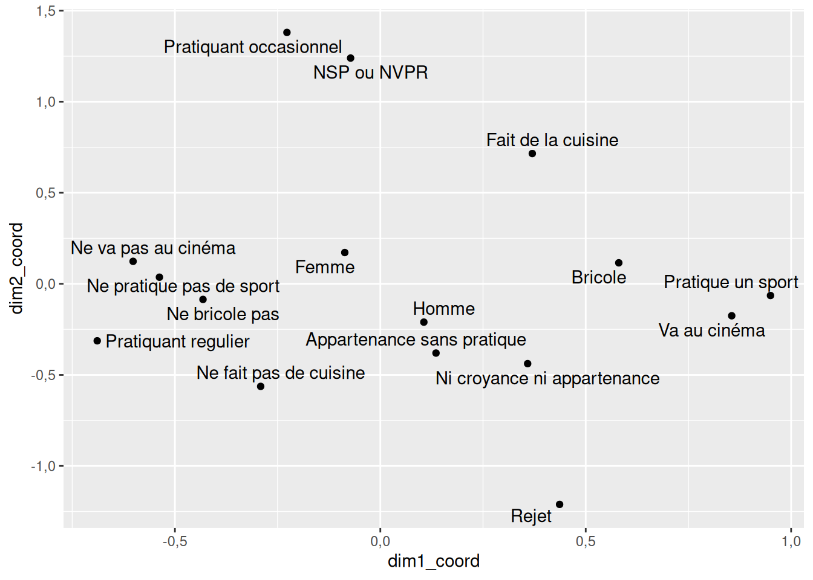

Cela peut être assez long à taper à la longue. La fonction
[`ggacm()`](https://nicolasville.github.io/ggacm/reference/ggacm.md)  
simplifie la production de graphiques, en plus de représenter les
cadrans et de rendre l’échelle de grandeur des abcsisses et des
ordonnées identiques.

``` r

modalités |> 
  ggacm() + # <- Initialise le graphique d'un coup
  geom_point() +
  geom_text_repel(aes(label = modalites)) 
```

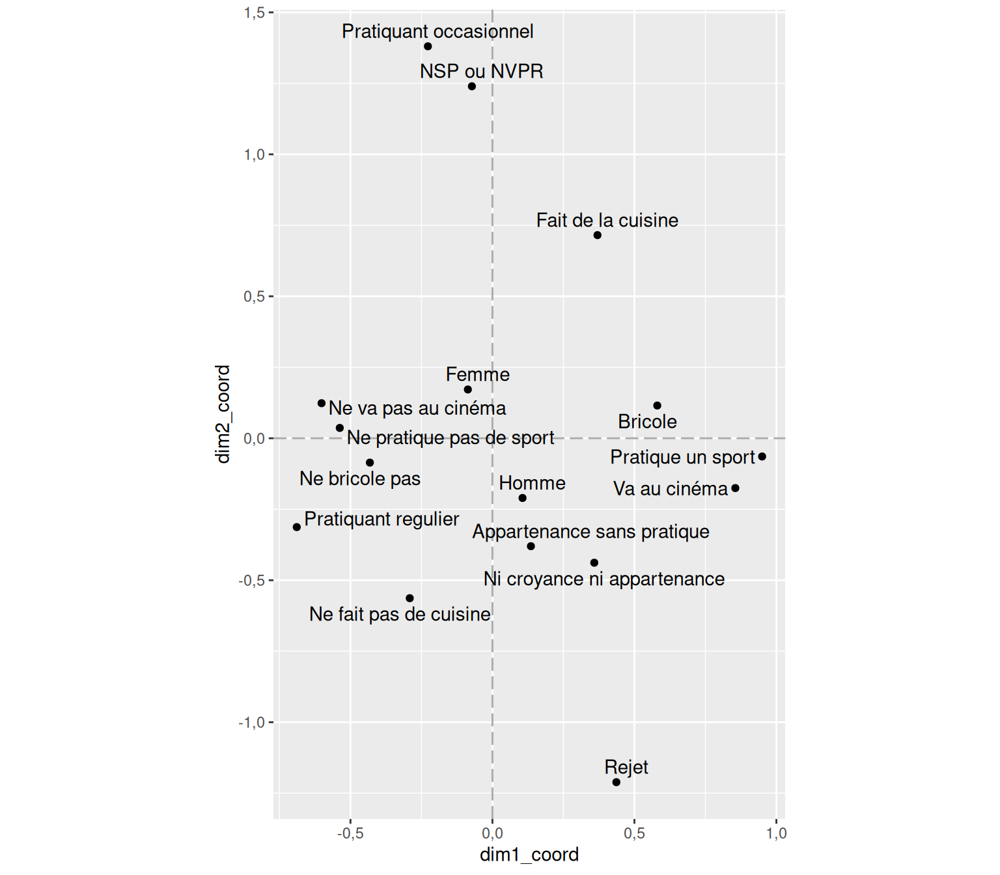

Voici le graphique “brut”. Souvent, des modalités n’ont pas assez de
place pour s’afficher, sont écrites trop grosses ou autres.

Dans quarto, on peut préciser dans le bloc de code la taille du
graphique qui sera produit avec `#| fig-height:` et `#| fig-height:` qui
fixent les dimensions (en pouce). En fonction des ACM, il faut essayer
différentes valeurs pour voir ce qui fonctionne le mieux. Les graphiques
que vous voyez utilisent

    #| fig-height: 7
    #| fig-width: 8

    Code_qui_génère_un_graphique

Jusqu’ici, toutes les variables ont été affiché sur les graphiques. Or,
souvent, on fait la différence entre les variables supplémentaires et
actives. Si on veut, on peut faire des graphiques différents. Par
exemple, ici ne sont affichés que les variables actives (on filtre le
tableau des modalités avant de l’injecter dans le graphique)

``` r

modalités |> 
  filter(type == "Variable active") |> # <- on ne garde que les variables actives
  ggacm() +
  geom_point() +
  geom_text_repel(aes(label = modalites)) 
```

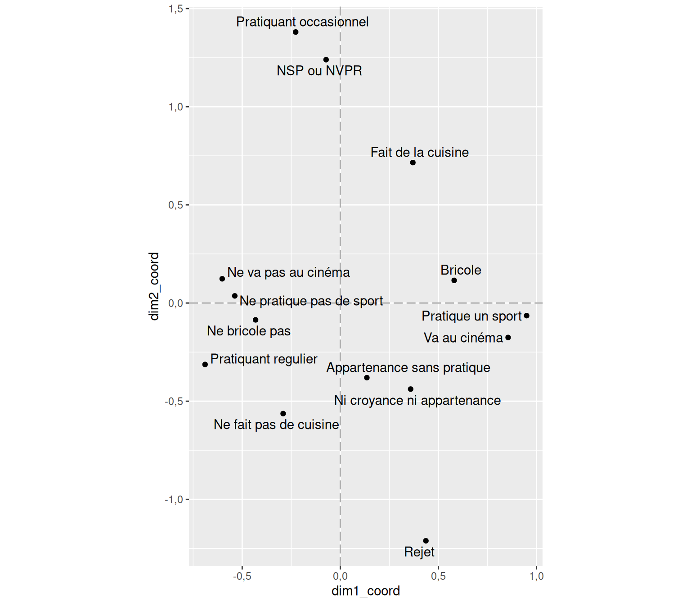

On peut aussi donner une forme différente au variables active et
supplémentaire. Ici, `aes(shape = type)` indique à ggplot de donner une
forme différente aux points en fonction du `type` de la modalité (active
ou supplémentaire). Pour plus de détails sur ce qu’il est possible de
faire, voir la section du manuel de
[ggplot](https://ggplot2-book.org/getting-started.html#sec-aesthetics).

``` r

modalités |> 
  ggacm() +
  geom_point(aes(shape = type)) +
  geom_text_repel(aes(label = modalites)) 
```

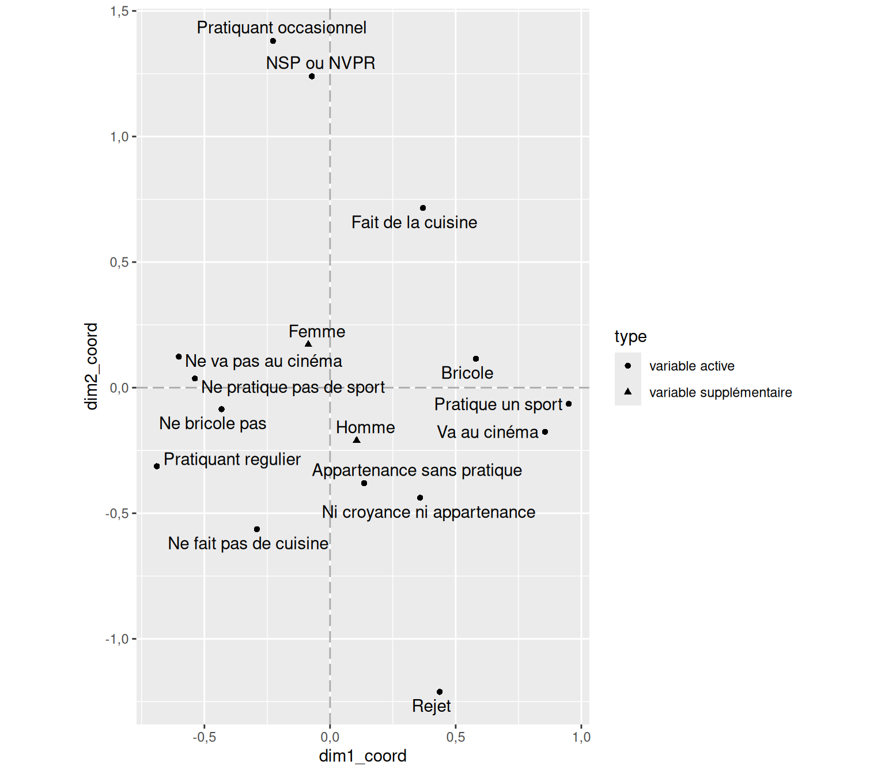

### Décorer ses graphiques

Voilà pour le graphique des modalités. On peut maintenant rajouter un
certain nombre de chose pour l’améliorer.

Je vais le stocker dans un objet `graph` pour commencer et éviter de
retaper toutes les commandes à chaque fois.

``` r

graph <- modalités |> 
  ggacm() +
  geom_point() +
  geom_text_repel(aes(label = modalites)) 
```

Cet objet est un graphique et on peut lui ajouter des éléments avec `+`
comme une légende ou un titre avec la fonction
[`labs()`](https://ggplot2.tidyverse.org/reference/labs.html). Cette
fonction permet également de renommer les axes.

``` r

graph + 
  labs(
    title = "ACM des pratiques culturelles",
    caption = "Réalisé à partir de l'enquête Histoire de Vie 2003 de l'INSEE.",
    x = "L'axe 1"
  )
```

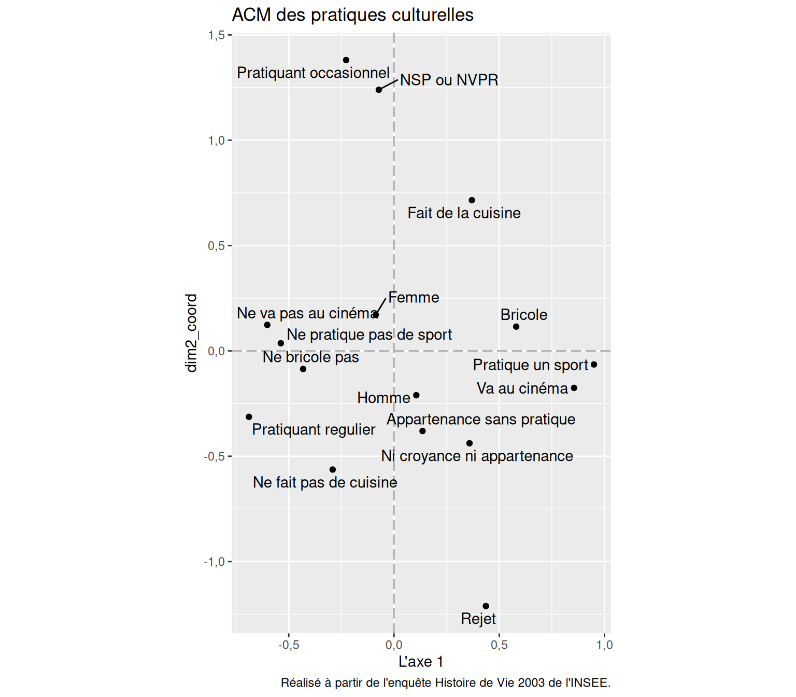

Le nom des axes est assez important dans les graphiques d’analyse des
correspondances. On aura tendance à les réutiliser dans tous les
graphiques. Pour plus d’ergonomie, il est possible de stocker les
intitulés des axes dans un objet qu’on rajoutera systématiquement au
graphique. La fonction
[`nommer_axes()`](https://nicolasville.github.io/ggacm/reference/nommer_axes.md)
aide à générer ces intitulés.

``` r

axes <- nommer_axes(res_acm, 
                    a_gauche = "Ne pratique pas",
                    a_droite = "Cumule de pratique", 
                    en_haut = "Chasse/pêche")
#> Warning: There was 1 warning in `mutate()`.
#> ℹ In argument: `Axes = forcats::fct_relevel(Axes, paste("Axe",
#>   1:nrow(resultat_acm$eig)))`.
#> Caused by warning:
#> ! 5 unknown levels in `f`: Axe 1, Axe 2, Axe 3, Axe 4, and Axe 5
#> There was 1 warning in `mutate()`.
#> ℹ In argument: `Axes = forcats::fct_relevel(Axes, paste("Axe",
#>   1:nrow(resultat_acm$eig)))`.
#> Caused by warning:
#> ! 5 unknown levels in `f`: Axe 1, Axe 2, Axe 3, Axe 4, and Axe 5


graph + axes
```

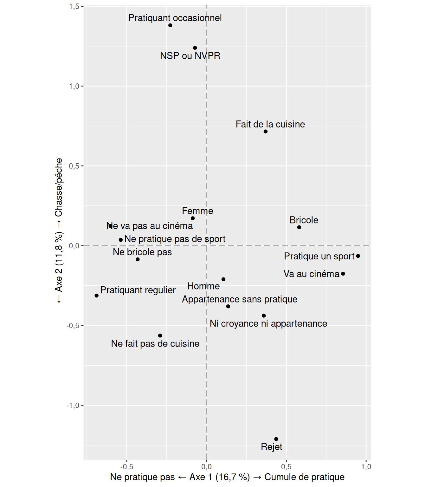

On peut également changer le thème esthétique du graphique. J’ai mis mes
préférences dans la fonction
[`theme_acm()`](https://nicolasville.github.io/ggacm/reference/theme_acm.md)
mais on peut en utiliser d’autres : voir sur le [site du package
ggplot2](https://ggplot2-book.org/themes.html#sec-themes).

``` r

graph + theme_acm()
```

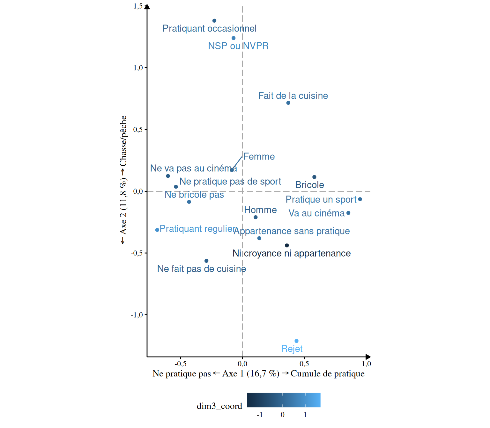

### Ajouter d’autres variables

On peut également rajouter d’autres “variables au graphique”. Pour cela,
il faut revenir à l’expression de base. Dans l’exemple suivant je
modifie la taille des points en fonction des effectifs en ajoutant
`aes(size = n)` dans la fonction qui trace les points. `n` est le nom de
la colonne du tableau de `modalités` qui contient les effectifs :

``` r

modalités |> 
  ggacm() +
  geom_point(aes(size = n)) + # <------
  geom_text_repel(aes(label = modalites)) +
  theme_acm() + 
  axes
```

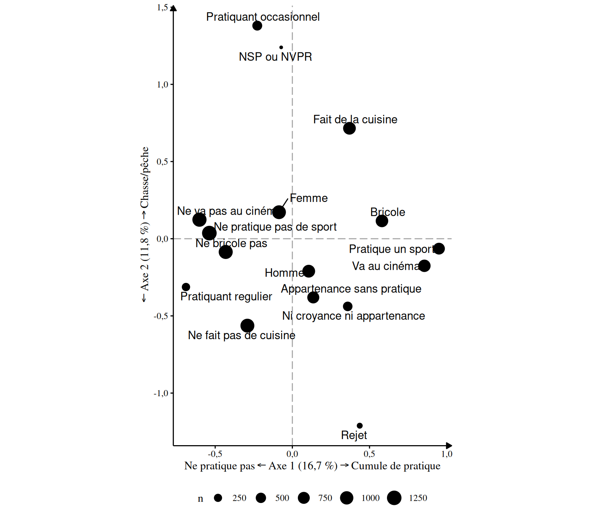

### Représenter un troisième axe

On peut de manière similaire ajouter à la représentation une échelle de
couleur en fonction des coordonnées sur l’axe 3.

``` r

modalités |> 
  ggacm() +
  aes(color = dim3_coord)+ 
  geom_point() +
  geom_text_repel(aes(label = modalites)) +
  theme_acm() + 
  axes
```

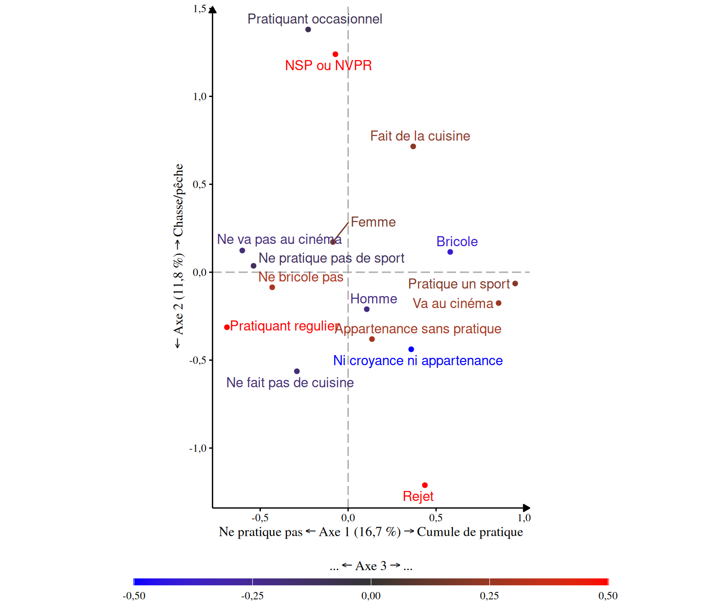

L’échelle de couleur n’est pas très adapté aux coordonnées d’une ACM, on
doit donc la changer pour une échelle divergente de couleur. Ce que l’on
peut faire avec
[`scale_color_gradient2()`](https://ggplot2.tidyverse.org/reference/scale_gradient.html).

Ici, je vais stocker dans un objet la liste des spécifications de cette
échelle dans un objet que je vais appeler `couleurs`.

L’argument `oob = scales::squish` permet de faire en sorte que les
points qui ne sont pas dans les limites de l’échelle (à moins de -0,5 ou
plus de 0,5) soient considérés pour la couleur comme comme étant égal à
-0,5 et 0,5. Cela évite qu’ils finissent gris. Pour plus de détails sur
les couleurs dans `ggplot2`, voir [la section
dédiée](https://ggplot2-book.org/scales-colour.html) du manuel.

La fonction
[`labs()`](https://ggplot2.tidyverse.org/reference/labs.html) permet de
rajouter un description de l’axe en couleur, qu’on pourra changer pour
ajouter le taux de variance par exemple.

Les spécifications de la fonction
[`theme()`](https://ggplot2.tidyverse.org/reference/theme.html) servent
à bien placer la légendes des couleurs sur le graphique (en bas du
graphique, avec le titre centré, etc. )

``` r

couleurs <- list(
  scale_color_gradient2(
    high = "red", # couleur des coordonnées positives
    low = "blue", # couleur des coordonnées négatives
    midpoint = 0, # milieu de l'échelle
    mid = "grey20", # couleur au milieu (ici 0)
    limits = c(-0.5, 0.5), # limites de l'échelle
    oob = scales::squish 
  ),
  labs(
    color = str_glue("... ← Axe 3 → ...") # intitulé de l'axe 3
    ),
  theme(legend.position = "bottom",
        legend.key.width = unit(2,"cm"),
        legend.key.height = unit(0.2, "cm"),
        legend.title.position = "top",
        legend.title = element_text(hjust = 0.5),
        legend.justification = "center") 
)
```

On peut maintenant réessayer avec la couleur :

``` r

modalités |> 
  ggacm() +
  aes(color = dim3_coord)+ 
  geom_point() +
  geom_text_repel(aes(label = modalites)) +
  theme_acm() + 
  axes +
  couleurs # <- les spécifications de l'échelle de couleur
```

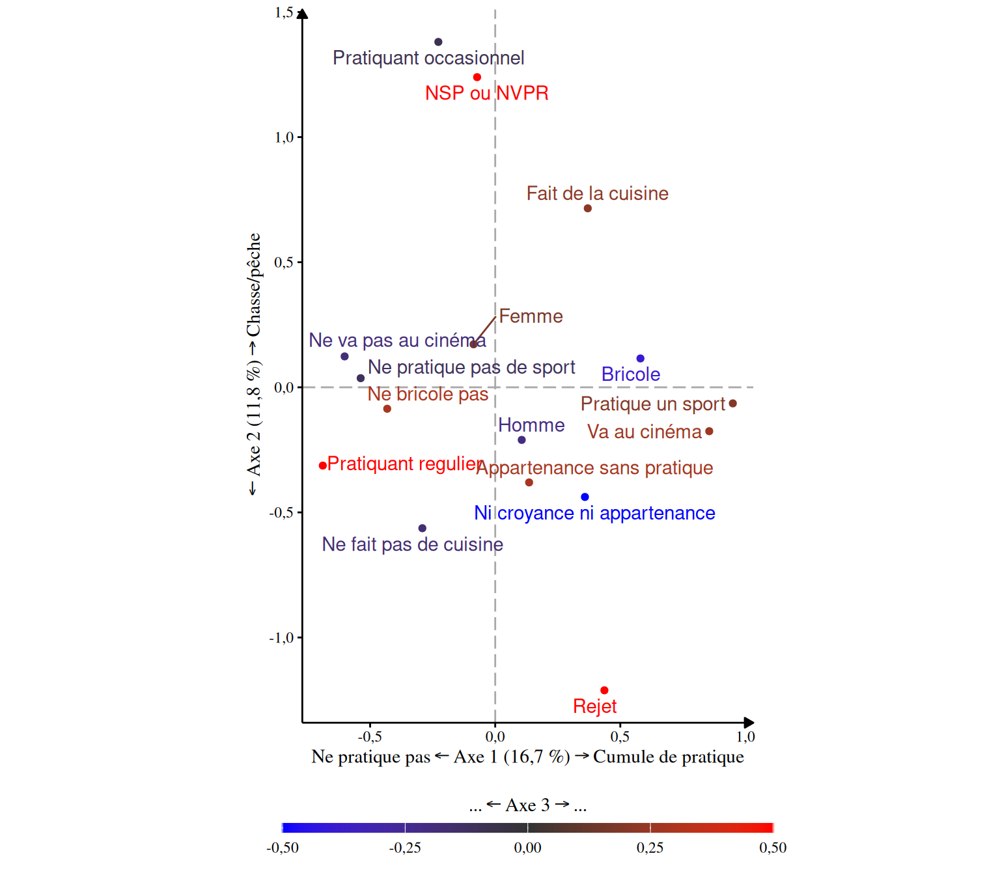

## Graphique des individus

Pour réaliser les graphiques des individus, la même logique s’applique :
on initialise le graphique avec
[`ggacm()`](https://nicolasville.github.io/ggacm/reference/ggacm.md),
puis on ajoute, couche après couche, ce dont on a besoin. A cela près
qu’on travaille non plus sur le tableau des `modalites`, mais celui des
`individus`.

On peut donc répéter le code plus haut. Au vu du nombre d’individus, il
n’est pas utile d’afficher leurs identifiants. Toutefois, s’ils étaient
moins nombreux on pourrait ajouter la même couche qu’on a utilisé pour
le texte des modalités en changeant ne nom de la colonne pour le texte
qu’on souhaite afficher. Par exemple si l’on voulait afficher
l’identifiant des individus, on rajouterait :
`geom_text_repel(aes(label = id))`.

``` r

individus |> 
  ggacm() +
  aes(color = dim3_coord)+ 
  geom_point() +
  theme_acm() + 
  axes +
  couleurs
```

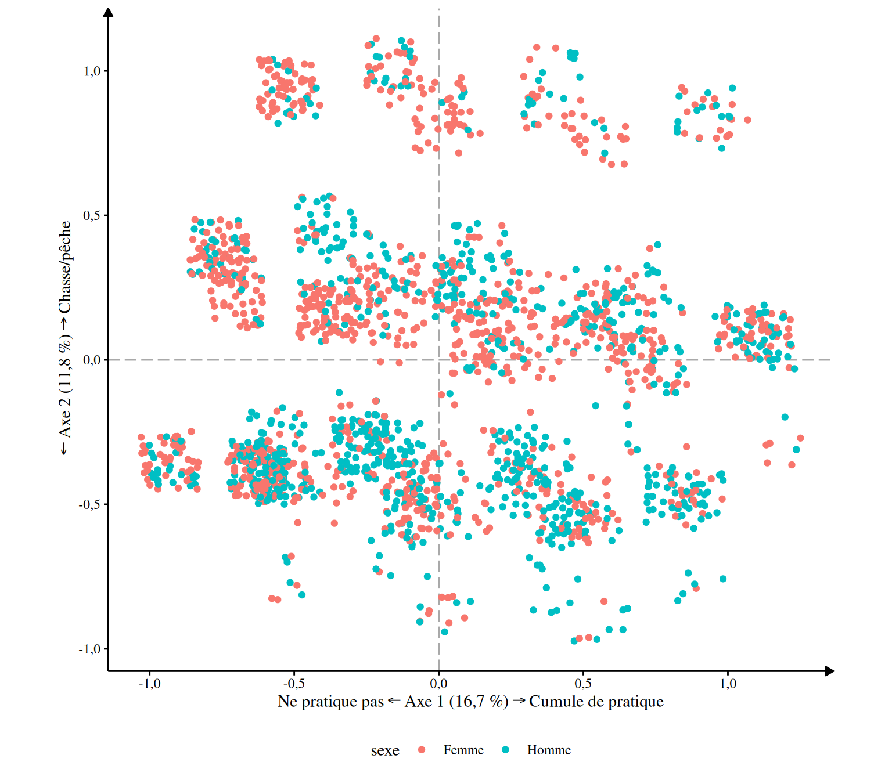

Ici, on remarque qu’on a pas exactement les 2000 points promis par les
individus les points sont concentrés… à certains points. L’ACM ayant été
réalisée sur un petit nombre de variable, les individus qui ont répondu
de manière identique au questionnaire sont placés au même endroit.

Dans ces cas là, pour se rendre un peu mieux compte du nombre, on peut
introduire un peu de bruit artificiel dans les points. On remplace
[`geom_point()`](https://ggplot2.tidyverse.org/reference/geom_point.html)
par
[`geom_jitter()`](https://ggplot2.tidyverse.org/reference/geom_jitter.html)
en précisant par exemple ici qu’on souhaite une variation de 0.1 unité
dans les deux directions. Les points seront alors placés aléatoirement
dans un carré de 0.1 sur 0.1 autour de leurs coordonnées.

``` r

individus |> 
  ggacm() +
  aes(color = dim3_coord)+ 
  geom_jitter(height = 0.1, width = 0.1) +
  theme_acm() + 
  axes +
  couleurs
```

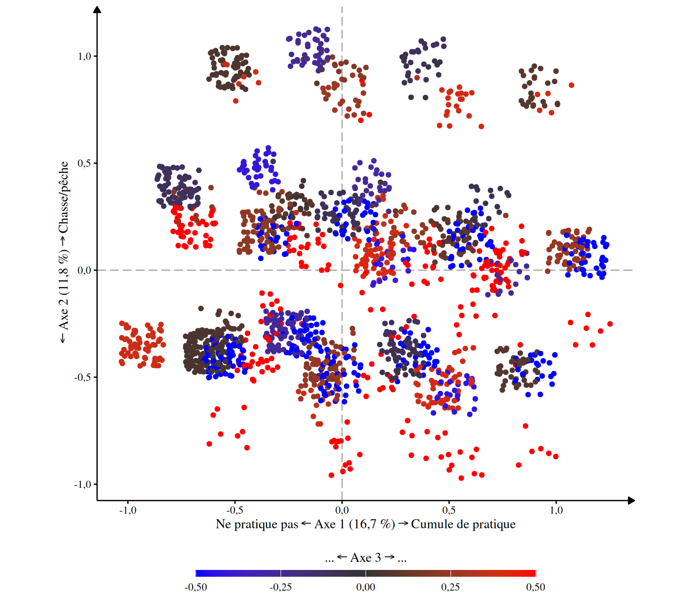

### Colorer le nuage d’individus

On a déjà vu comment colorer le nuage selon les coordonnées sur l’axe 3.
Rien ne nous empêche cependant d’utiliser la couleur pour autre chose.
Comme par exemple pour observer la répartition d’une variable dans le
nuage des individus.

``` r

individus |> 
  ggacm() +
  aes(color = sexe) + # <------ 
  geom_jitter(height = 0.1, width = 0.1) +
  theme_acm() + 
  axes 
```

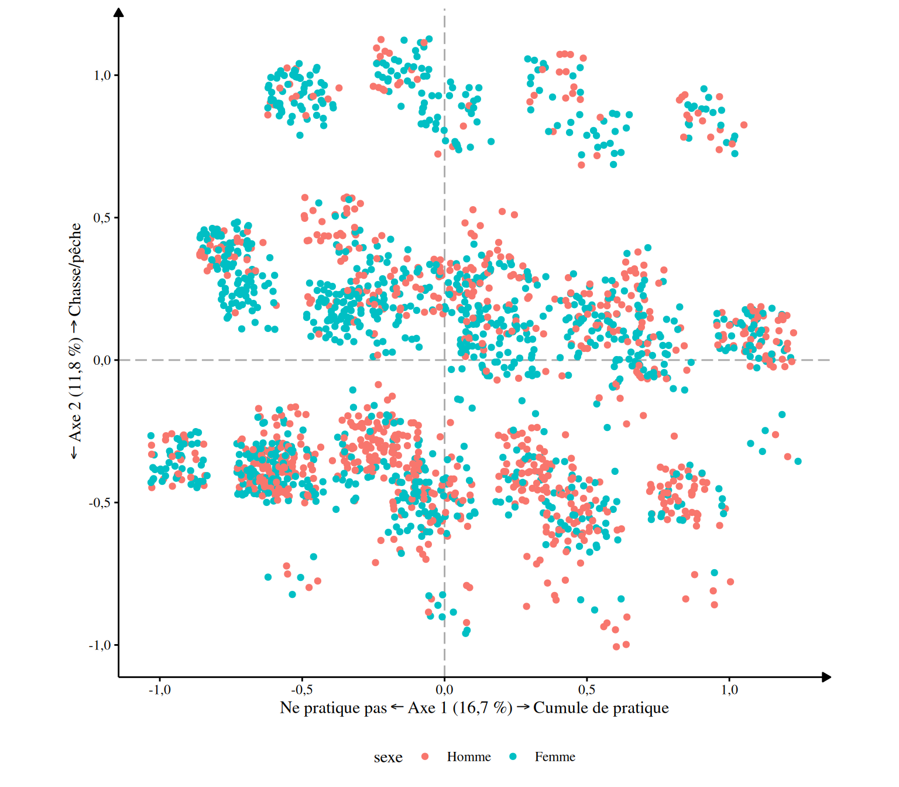

Ce type de représentation peut-être automatisé et répéter sur un grand
nombre de modalités avec la fonction
[`facet_wrap()`](https://ggplot2.tidyverse.org/reference/facet_wrap.html)
de `ggplot2`. La fonction est un peu compliquée. Il faut procéder en
plusieurs étapes.

D’abord, il faut sélectionner les modalités que l’on souhaite afficher.
Ici, je vais prendre les 5 modalités qui contribuent le plus à l’axe 1.
On pourrait utiliser d’autres critères cela dit (liste personnalisée,
toutes les modalités qui ont une contribution supérieur à un seuil,
etc.)

``` r

modalites_a_representer <- modalités |> # tableau des modalités
  arrange(desc(dim1_contrib)) |>  # trié de la contribution à l'axe 1 la plus grande
  head(5) |> # on garde les 5 premières lignes
  pull(modalites) # on extrait la colonne avec le nom des modalités.

modalites_a_representer
#> [1] "Pratique un sport"        "Va au cinéma"            
#> [3] "Ne va pas au cinéma"      "Ne pratique pas de sport"
#> [5] "Bricole"
```

Une fois cette liste prise on va créer un jeu de données qui recensera,
pour chaque graphique, la liste des individus à mettre en valeur.

``` r

individus_concernés <- individus |>
  pivot_longer(
    cols = !starts_with("dim"),
    names_to = "variable",
    values_to = "modalite",
    values_transform = as.character) |> 
  filter(modalite %in% modalites_a_representer) |> 
  mutate(
    modalite = fct(modalite, levels = modalites_a_representer)
  )

individus_concernés |> 
  select(modalite, dim1_coord, dim2_coord) 
#> # A tibble: 4.853 × 3
#>    modalite                 dim1_coord dim2_coord
#>    <fct>                         <dbl>      <dbl>
#>  1 Ne va pas au cinéma        -0.308       0.152 
#>  2 Ne pratique pas de sport   -0.308       0.152 
#>  3 Va au cinéma                0.526      -0.576 
#>  4 Pratique un sport           0.526      -0.576 
#>  5 Ne va pas au cinéma        -0.00599    -0.446 
#>  6 Pratique un sport          -0.00599    -0.446 
#>  7 Bricole                     1.06        0.0914
#>  8 Va au cinéma                1.06        0.0914
#>  9 Pratique un sport           1.06        0.0914
#> 10 Ne va pas au cinéma        -0.932      -0.348 
#> # ℹ 4.843 more rows
```

Ce tableau recense pour chaque modalité, toutes les coordonnées des
individus concernés.

On peut ensuite construire le graphique couche par couche à partir de
notre nouveau tableau. On l’initialise comme d’habitude avec
[`ggacm()`](https://nicolasville.github.io/ggacm/reference/ggacm.md).
Puis, on indique à ggplot qu’on souhaitera produire un graphique
différent pour chaque modalités avec `facet_wrap(~ modalite)`.
L’argument `labeller` est ici pour faire sauter une ligne dans les
labels au cas où le texte d’une modalité serait trop grand.

On peut ensuite commencer à construire le graphique qui sera répété. On
commence par une première couche de points
([`geom_point()`](https://ggplot2.tidyverse.org/reference/geom_point.html))
qui reproduit le nuage d’individus en gris pour se repérer. Cette couche
fait appel au nuage de **tous** les individus, on précise donc qu’on
veut utiliser ce tableau (et pas celui des `individus_concernés`comme ce
sera le cas dans le reste du graphique) avec `data = individus`.

On rajoute dessus une deuxième couche de carrés rouges, qui s’imprimera
au dessus de la couche précédente uniquement pour les individus
concernés.

Quand on lance la fonction ggplot va refaire ce travail, pour chaque
modalité sur un graphique différent, avant de les “coller” ensemble.

``` r

individus_concernés |> 
    ggacm() +
    facet_wrap(
      ~ modalite, # <-- = répéter pour chaque modalités
      labeller = labeller(modalites = label_wrap_gen(width = 20))
    )+
    geom_point(
      data = individus, # <--- Important !
      color = "darkgrey",
      show.legend = FALSE
    ) +
    geom_point(
      color = "red",
      shape = "square", 
      size = 2 # pour qu'ils recouvrent complètmeent les points gris. 
    ) +
  theme_acm() +
  axes
```

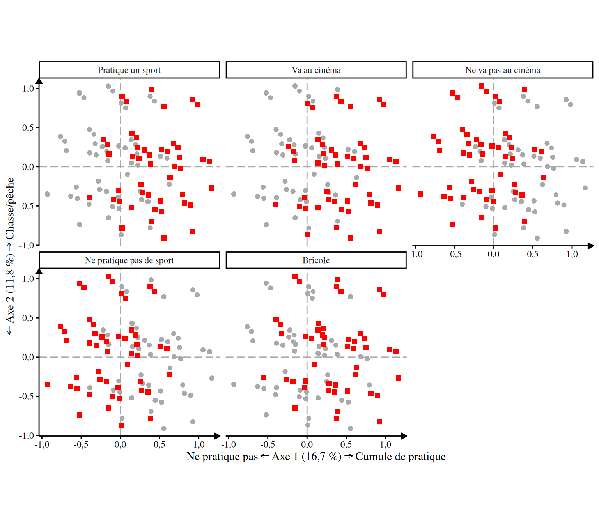

Pour plus de détails sur
[`facet_wrap()`](https://ggplot2.tidyverse.org/reference/facet_wrap.html),
voir la section dédiée du
\[manuel\](https://ggplot2-book.org/facet.html#sec-facet-wrap.

## Classification

On peut gérer avec un processus similaire les classifications. On
commence par réaliser la classification et la stocker dans un objet
dédiée : `res_cah`.

``` r

res_cah <- res_acm |> 
  FactoMineR::HCPC(nb.clust = 3, graph = FALSE)
```

Pour obtenir le dendrogramme :

``` r

res_cah |> plot(choice = "tree")
```


De manière similaire à avant, on commence par extraire les résultats de
la CAH de `res_cah`. La fonction
[`extraire_classes()`](https://nicolasville.github.io/ggacm/reference/extraire_classes.md)
renvoie notre tableau de données initiale auquel a été rajouté une
colonne `classe` contenant la classe attributé par l’algorithme à cet
individus.

``` r

individus_classés <- extraire_classes(res_cah)

individus_classés
#> # A tibble: 2.000 × 23
#>    classe dim1_coord dim2_coord    id sexe  cuisine    bricol cinema relig sport
#>    <fct>       <dbl>      <dbl> <int> <fct> <fct>      <fct>  <fct>  <fct> <fct>
#>  1 2        -0.308       0.152      5 Femme Ne fait p… Ne br… Ne va… Prat… Ne p…
#>  2 2         0.526      -0.576     24 Femme Ne fait p… Ne br… Ne va… Prat… Ne p…
#>  3 2        -0.00599    -0.446     39 Femme Ne fait p… Ne br… Ne va… Prat… Ne p…
#>  4 2         1.06        0.0914    45 Femme Ne fait p… Ne br… Ne va… Prat… Ne p…
#>  5 2        -0.932      -0.348     53 Homme Ne fait p… Ne br… Ne va… Prat… Ne p…
#>  6 2         0.526      -0.576     78 Femme Ne fait p… Ne br… Ne va… Prat… Ne p…
#>  7 2        -0.389       0.178     83 Femme Ne fait p… Ne br… Ne va… Prat… Ne p…
#>  8 2         0.0619      0.239    159 Homme Ne fait p… Ne br… Ne va… Prat… Ne p…
#>  9 2        -0.0985     -0.507    246 Homme Ne fait p… Ne br… Ne va… Prat… Ne p…
#> 10 2         0.312       0.213    266 Femme Ne fait p… Ne br… Ne va… Prat… Ne p…
#> # ℹ 1.990 more rows
#> # ℹ 13 more variables: dim3_coord <dbl>, dim4_coord <dbl>, dim5_coord <dbl>,
#> #   dim1_contrib <dbl>, dim2_contrib <dbl>, dim3_contrib <dbl>,
#> #   dim4_contrib <dbl>, dim5_contrib <dbl>, dim1_cos2 <dbl>, dim2_cos2 <dbl>,
#> #   dim3_cos2 <dbl>, dim4_cos2 <dbl>, dim5_cos2 <dbl>
```

Pour faire le graphique des individus selon la classe, on peut tout
simplement reprendre le code du nuage des individus en précisant qu’il
faudra donner une couleur selon la variable qui code la classe.

La palette par défaut de ggplot n’est pas très lisible, contrairement à
la palette Dark2 de Color Brewer.

``` r

individus_classés |> 
  ggacm() +
  aes(color = classe) + # <------
  geom_point(aes(shape = classe)) +
  axes + 
  scale_color_brewer(palette = "Dark2") + # (change la palette de couleur) 
  theme_acm()
```

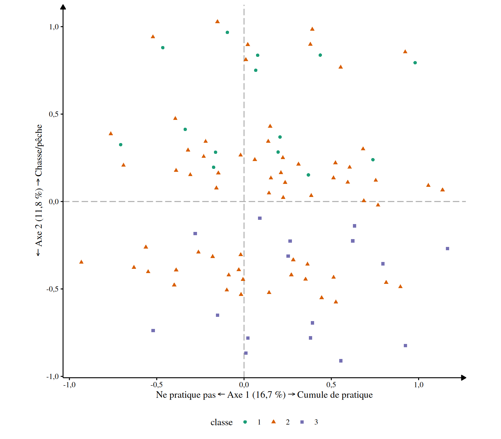

On pourra revenir à ce graphique une fois qu’on aura caractérisé les
classes pour leur donner un nom par exemple. Dans ce cas là, on recode
la colonne `classe` du tableau `individus_classés` en utilisant la
fonction
[`fct_recode()`](https://forcats.tidyverse.org/reference/fct_recode.html)
de `forcats`. La classe 1 est recodée en `[Nom de classe]`, idem pour la
2 et la 3…

``` r

individus_classés<- individus_classés |> 
  mutate(
    classe = classe |>
      fct_recode(
        "[Nom de classe]" = "1",
        "[Autre nom de classe]" = "2",
        "[Les autres]" = "3"
    ) 
  )

individus_classés
#> # A tibble: 2.000 × 23
#>    classe    dim1_coord dim2_coord    id sexe  cuisine bricol cinema relig sport
#>    <fct>          <dbl>      <dbl> <int> <fct> <fct>   <fct>  <fct>  <fct> <fct>
#>  1 [Autre n…   -0.308       0.152      5 Femme Ne fai… Ne br… Ne va… Prat… Ne p…
#>  2 [Autre n…    0.526      -0.576     24 Femme Ne fai… Ne br… Ne va… Prat… Ne p…
#>  3 [Autre n…   -0.00599    -0.446     39 Femme Ne fai… Ne br… Ne va… Prat… Ne p…
#>  4 [Autre n…    1.06        0.0914    45 Femme Ne fai… Ne br… Ne va… Prat… Ne p…
#>  5 [Autre n…   -0.932      -0.348     53 Homme Ne fai… Ne br… Ne va… Prat… Ne p…
#>  6 [Autre n…    0.526      -0.576     78 Femme Ne fai… Ne br… Ne va… Prat… Ne p…
#>  7 [Autre n…   -0.389       0.178     83 Femme Ne fai… Ne br… Ne va… Prat… Ne p…
#>  8 [Autre n…    0.0619      0.239    159 Homme Ne fai… Ne br… Ne va… Prat… Ne p…
#>  9 [Autre n…   -0.0985     -0.507    246 Homme Ne fai… Ne br… Ne va… Prat… Ne p…
#> 10 [Autre n…    0.312       0.213    266 Femme Ne fai… Ne br… Ne va… Prat… Ne p…
#> # ℹ 1.990 more rows
#> # ℹ 13 more variables: dim3_coord <dbl>, dim4_coord <dbl>, dim5_coord <dbl>,
#> #   dim1_contrib <dbl>, dim2_contrib <dbl>, dim3_contrib <dbl>,
#> #   dim4_contrib <dbl>, dim5_contrib <dbl>, dim1_cos2 <dbl>, dim2_cos2 <dbl>,
#> #   dim3_cos2 <dbl>, dim4_cos2 <dbl>, dim5_cos2 <dbl>
```

On peut ensuite refaire ensuite le graphique en affichant le nom des
classes :

``` r

individus_classés |> 
  ggacm() +
  aes(color = classe)+ 
  geom_point(aes(shape = classe)) +
  axes + 
  scale_color_brewer(palette = "Dark2") + # (change la palette de couleur) 
  theme_acm()
```

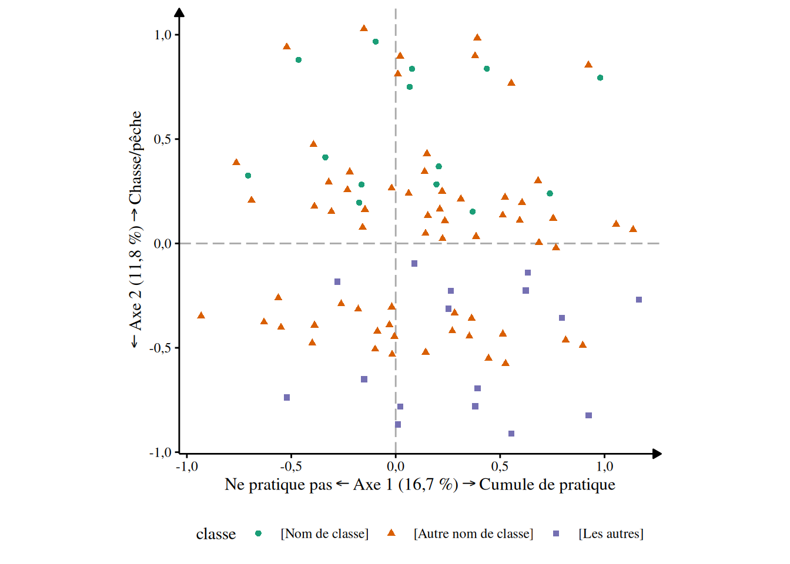

### Tableau de description

Les tableaux de description de positions des membres des classes sur les
différents axes peuvent être accessible comme ceci :

``` r

res_cah$desc.axes$quanti |>
  map(\(x) x |> as.data.frame() |> round(digits = 2))
#> $`1`
#>       v.test Mean in category Overall mean sd in category Overall sd p.value  n
#> Dim 5  35,66             2,50            0           0,00       0,45       0 40
#> Dim 4  24,16             1,70            0           0,08       0,45       0 40
#> Dim 2   7,92             0,57            0           0,30       0,46       0 40
#> Dim 3   4,19             0,30            0           0,17       0,45       0 40
#> 
#> $`2`
#>       v.test Mean in category Overall mean sd in category Overall sd p.value
#> Dim 2   5,66             0,02            0           0,45       0,46    0,00
#> Dim 5  -2,56            -0,01            0           0,19       0,45    0,01
#> Dim 1  -3,38            -0,01            0           0,55       0,55    0,00
#> Dim 3 -16,26            -0,04            0           0,43       0,45    0,00
#> Dim 4 -40,49            -0,11            0           0,19       0,45    0,00
#>          n
#> Dim 2 1867
#> Dim 5 1867
#> Dim 1 1867
#> Dim 3 1867
#> Dim 4 1867
#> 
#> $`3`
#>       v.test Mean in category Overall mean sd in category Overall sd p.value  n
#> Dim 4  31,84             1,45            0           0,09       0,45       0 93
#> Dim 3  16,45             0,75            0           0,20       0,45       0 93
#> Dim 1   4,31             0,24            0           0,48       0,55       0 93
#> Dim 2 -11,96            -0,56            0           0,30       0,46       0 93
#> Dim 5 -20,67            -0,94            0           0,00       0,45       0 93
```

On peut ensuite, pour chaque classe, décrire finement la composition de
celle-ci ainsi que sa place dans la population globale :

``` r

caracteriser_classe(res_cah, 1)
```

[TABLE]

``` r

caracteriser_classe(res_cah, 2)
```

[TABLE]

``` r

caracteriser_classe(res_cah, 3)
```

[TABLE]
