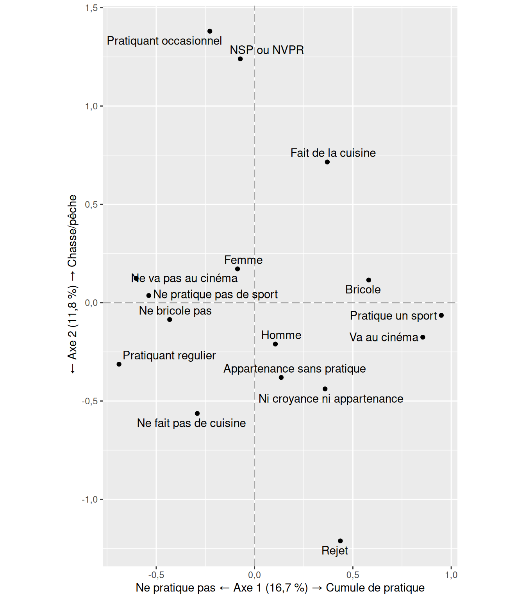
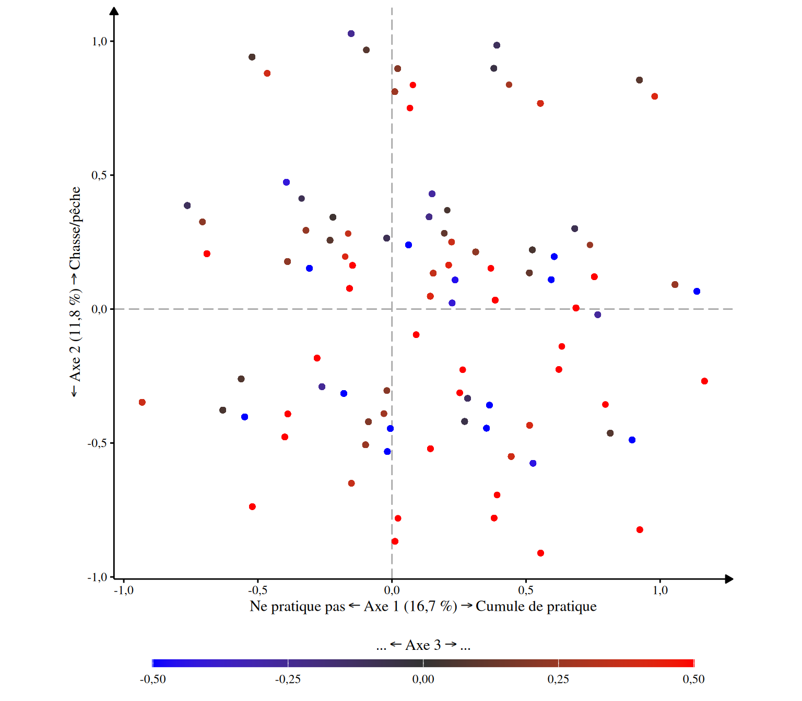
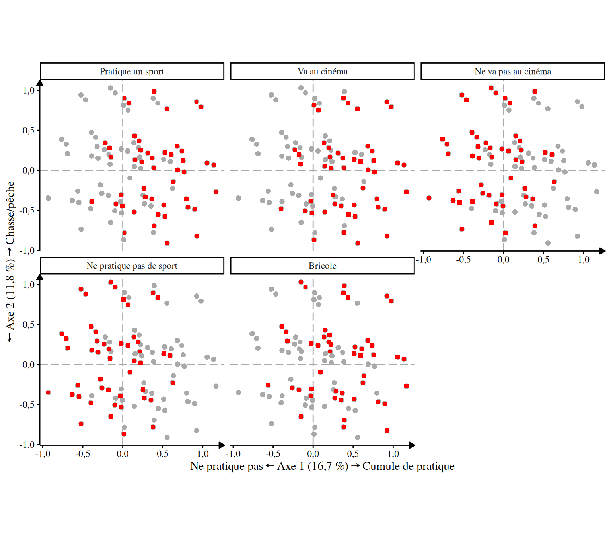

# ACM avec R

Ceci est un document qui contient le code utilisé pour réalisé les ACM.
Si ce n’est pas déjà fait, il va falloir installer les packages qui sont
utilisés.

La plupart du code que j’ai fait est mis dans un package sur github.
Pour l’ installer, il suffit de faire `pak::pak("nicolasville/ggacm)` (à
condition d’ avoir installé le package `pak` auparavant pour faire
l’installation.)

## Setup

``` r

library(tidyverse)
#> ── Attaching core tidyverse packages ──────────────────────── tidyverse 2.0.0 ──
#> ✔ dplyr     1.2.1     ✔ readr     2.2.0
#> ✔ forcats   1.0.1     ✔ stringr   1.6.0
#> ✔ ggplot2   4.0.3     ✔ tibble    3.3.1
#> ✔ lubridate 1.9.5     ✔ tidyr     1.3.2
#> ✔ purrr     1.2.2     
#> ── Conflicts ────────────────────────────────────────── tidyverse_conflicts() ──
#> ✖ dplyr::filter() masks stats::filter()
#> ✖ dplyr::lag()    masks stats::lag()
#> ℹ Use the conflicted package (<http://conflicted.r-lib.org/>) to force all conflicts to become errors
library(ggacm) # charge le package
library(gtsummary)
library(ggrepel)

mise_en_place_ACM()
#> 
#> ── Les options générales de la session R ont été modifié. 
#> ✔ Les nombres décimaux s'afficheront avec une virgule.
#> ✔ Ils n'afficheront que 3 chiffres après la virgule.
#> ✔ L'écriture scientifique a été désactivé.
#> ── Le thème des tableaux produit par gtsummary a été modifié. 
#> ✔ Ils s'afficheront en français.
#> ✔ En utilisant une virgule pour les nombres décimaux.
```

Import

Je commence par charger le résultat de l’ACM. Ici, je vais utiliser le
jeu de donnée du package `questionr` qui correspond à un extrait de
l’enquête *Histoire de Vie* de l’INSEE en 2003.

Je ne prend que certaines colonnes qui sont relatives à l’ID de
l’individu, et certaines pratiques.

``` r


data("hdv2003", package = "questionr") # charge les données en mémoire

hdv2003 <- hdv2003 |> 
  select(id, 
         sexe,
         cuisine, 
         bricol, 
         cinema, 
         relig,
         sport) |> # sélectionne les colonnes id, genre et de hard.rock à sport
  tibble()

hdv2003
#> # A tibble: 2.000 × 7
#>       id sexe  cuisine bricol cinema relig                       sport
#>    <int> <fct> <fct>   <fct>  <fct>  <fct>                       <fct>
#>  1     1 Femme Oui     Non    Non    Ni croyance ni appartenance Non  
#>  2     2 Femme Non     Non    Oui    Ni croyance ni appartenance Oui  
#>  3     3 Homme Non     Non    Non    Ni croyance ni appartenance Oui  
#>  4     4 Homme Oui     Oui    Oui    Appartenance sans pratique  Oui  
#>  5     5 Femme Non     Non    Non    Pratiquant regulier         Non  
#>  6     6 Femme Non     Non    Oui    Ni croyance ni appartenance Oui  
#>  7     7 Femme Oui     Non    Non    Appartenance sans pratique  Non  
#>  8     8 Homme Oui     Oui    Non    Ni croyance ni appartenance Non  
#>  9     9 Femme Non     Non    Oui    Appartenance sans pratique  Non  
#> 10    10 Homme Non     Non    Oui    Pratiquant occasionnel      Oui  
#> # ℹ 1.990 more rows
```

Pour faire un tableau résumé, on peut faire :

``` r

hdv2003 |> 
  tbl_summary(include = -id) # toutes les variables sauf l'identifiant
```

[TABLE]

Comme ça fait pas mal de modalités oui/non, je les recode pour qu’elles
soient toutes différentes et plus claires. (L’IA génère bien ces
recodages en général)

``` r

hdv2003 <- hdv2003 |>   
  mutate(
    cuisine = cuisine |>
      fct_recode(
        "Fait de la cuisine"     = "Oui",
        "Ne fait pas de cuisine" = "Non"
      ),
    bricol = bricol |>
      fct_recode(
        "Bricole"        = "Oui",
        "Ne bricole pas" = "Non"
      ),
    cinema = cinema |>
      fct_recode(
        "Va au cinéma"        = "Oui",
        "Ne va pas au cinéma" = "Non"
      ),
    sport = sport |>
      fct_recode(
        "Pratique un sport"        = "Oui",
        "Ne pratique pas de sport" = "Non"
      )
  )

hdv2003
#> # A tibble: 2.000 × 7
#>       id sexe  cuisine                bricol         cinema          relig sport
#>    <int> <fct> <fct>                  <fct>          <fct>           <fct> <fct>
#>  1     1 Femme Fait de la cuisine     Ne bricole pas Ne va pas au c… Ni c… Ne p…
#>  2     2 Femme Ne fait pas de cuisine Ne bricole pas Va au cinéma    Ni c… Prat…
#>  3     3 Homme Ne fait pas de cuisine Ne bricole pas Ne va pas au c… Ni c… Prat…
#>  4     4 Homme Fait de la cuisine     Bricole        Va au cinéma    Appa… Prat…
#>  5     5 Femme Ne fait pas de cuisine Ne bricole pas Ne va pas au c… Prat… Ne p…
#>  6     6 Femme Ne fait pas de cuisine Ne bricole pas Va au cinéma    Ni c… Prat…
#>  7     7 Femme Fait de la cuisine     Ne bricole pas Ne va pas au c… Appa… Ne p…
#>  8     8 Homme Fait de la cuisine     Bricole        Ne va pas au c… Ni c… Ne p…
#>  9     9 Femme Ne fait pas de cuisine Ne bricole pas Va au cinéma    Appa… Ne p…
#> 10    10 Homme Ne fait pas de cuisine Ne bricole pas Va au cinéma    Prat… Prat…
#> # ℹ 1.990 more rows
```

Je sélectionne ensuite les variables pour l’ACM avec quelque chose de ce
genre

``` r

variables_supplémentaires <- hdv2003 |> # prend le jeu de donnée
  select(id, sexe) |> # sélectionne certaines colonnes
  names() # ne garde que le nom

variables_supplémentaires
#> [1] "id"   "sexe"
```

Et du coup on peut garder les variables actives dans un autre vecteur

``` r

variables_actives <- hdv2003 |>
  select(-all_of(variables_supplémentaires)) |> # sélectionne tout sauf les variables supplémentaires
  names() # et on prend leur nom

variables_actives
#> [1] "cuisine" "bricol"  "cinema"  "relig"   "sport"
```

On peut maintenant faire l’ACM avec
[`FactoMineR::MCA`](https://rdrr.io/pkg/FactoMineR/man/MCA.html), en
précisant les variables supplémentaires :

``` r

res_acm <- hdv2003 |> 
  FactoMineR::MCA(quali.sup = variables_supplémentaires)
#> Warning in sqrt(Nj * ((N - 1)/(N - Nj))): NaNs produced
```

FactoMineR produit déjà des graphiques. L’analyse est donc faite. Tous
les résultats sont stockés dans l’objet `res_acm` qui est une liste de
résutlat.

Le package étant un peu daté, la plupart des sorties sont moches. J’ai
codé quelques fonctions pour sortir plus facilement les résultats et les
mettre en graphiques que j’ai mis dans un package (`ggacm`).

On peut maintenant décrire les axes. Pour les taux modifiés, j’utilise
`modif.rate()` du package `GDAtools`.

``` r

ggacm::extraire_variance(res_acm)
#>    Axes Valeurs propres % de variance % cumulé de variance
#> 1 Axe 1            0,30        16,7 %               16,7 %
#> 2 Axe 2            0,21        11,8 %               28,5 %
#> 3 Axe 3            0,20        11,3 %               39,8 %
#> 4 Axe 4            0,20        11,2 %               50,9 %
#> 5 Axe 5            0,20        11,1 %                 62 %

GDAtools::modif.rate(res_acm)$modif
#>                                   mrate cum.mrate
#> dim 1 98,327888836411702300210890825838      98,3
#> dim 2  1,571688705421736997891457576770      99,9
#> dim 3  0,094352963276206666676237944102     100,0
#> dim 4  0,006069494890357363288402314794     100,0
#> dim 5  0,000000000000000000000000000757     100,0
```

## Description des axes

La description des axes ce fait comme ceci :

#### Axe 1

``` r

caracteriser_axe(res_acm, 1)
#> Vous n'axez pas indiqué de contribution minimum pour afficher les résultats
#> Seules les modalités dont la contribution est supérieur à la moyenne théorique
#> seront affichées.
#> ℹ Si vous souhaitez modifier cela, vous pouvez changer l'argument
#>   contribution_minimum
#> → `contribution_minimum = 0` si vous souhaitez afficher toutes les modalités
#>   par exemple
#> 
#> 
#> ── Contribution moyenne théorique 
#> 
#> ℹ Si toutes les modalités actives contribuaient également à la construction
#> d'un axe, chacune aurait une contribution de 7,14 %.
```

| Modalité¹ | Contribution | Coordonnée² | Cos² | V-test | Effectif |
|----|----|----|----|----|----|
| Coordonnées positives |  |  |  |  |  |
| Pratique un sport | 21,7 % | 0,950 | 0,511 | 32,0 | 723 (36 %) |
| Va au cinéma | 20,1 % | 0,855 | 0,515 | 32,1 | 826 (41 %) |
| Bricole | 9,6 % | 0,580 | 0,251 | 22,4 | 853 (43 %) |
| Coordonnées négatives |  |  |  |  |  |
| Ne va pas au cinéma | 14,2 % | -0,602 | 0,515 | -32,1 | 1174 (59 %) |
| Ne pratique pas de sport | 12,3 % | -0,538 | 0,511 | -32,0 | 1277 (64 %) |
| ¹ Seules les modalités actives dont la contribution est supérieure à 7,14 % sont représentées. |  |  |  |  |  |
| ² Moyenne des coordonnées des individus partageant la modalité |  |  |  |  |  |

#### Axe 2

``` r

caracteriser_axe(res_acm, 2)
#> Vous n'axez pas indiqué de contribution minimum pour afficher les résultats
#> Seules les modalités dont la contribution est supérieur à la moyenne théorique
#> seront affichées.
#> ℹ Si vous souhaitez modifier cela, vous pouvez changer l'argument
#>   contribution_minimum
#> → `contribution_minimum = 0` si vous souhaitez afficher toutes les modalités
#>   par exemple
#> 
#> 
#> ── Contribution moyenne théorique 
#> 
#> ℹ Si toutes les modalités actives contribuaient également à la construction
#> d'un axe, chacune aurait une contribution de 7,14 %.
```

| Modalité¹ | Contribution | Coordonnée² | Cos² | V-test | Effectif |
|----|----|----|----|----|----|
| Coordonnées positives |  |  |  |  |  |
| Pratiquant occasionnel | 39,6 % | 1,380 | 0,541 | 32,9 | 442 (22 %) |
| Fait de la cuisine | 21,2 % | 0,715 | 0,403 | 28,4 | 881 (44 %) |
| Coordonnées négatives |  |  |  |  |  |
| Ne fait pas de cuisine | 16,7 % | -0,563 | 0,403 | -28,4 | 1119 (56 %) |
| ¹ Seules les modalités actives dont la contribution est supérieure à 7,14 % sont représentées. |  |  |  |  |  |
| ² Moyenne des coordonnées des individus partageant la modalité |  |  |  |  |  |

#### Axe 3

``` r

caracteriser_axe(res_acm, 3, contribution_minimum = 3)
```

| Modalité¹ | Contribution | Coordonnée² | Cos² | V-test | Effectif |
|----|----|----|----|----|----|
| Coordonnées positives |  |  |  |  |  |
| Pratiquant regulier | 13,3 % | 1,007 | 0,156 | 17,6 | 266 (13 %) |
| Rejet | 12,7 % | 1,666 | 0,135 | 16,5 | 93 (5 %) |
| Ne bricole pas | 4,9 % | 0,294 | 0,116 | 15,3 | 1147 (57 %) |
| Coordonnées négatives |  |  |  |  |  |
| Ni croyance ni appartenance | 48,3 % | -1,568 | 0,613 | -35,0 | 399 (20 %) |
| Bricole | 6,6 % | -0,396 | 0,116 | -15,3 | 853 (43 %) |
| ¹ Seules les modalités actives dont la contribution est supérieure à 3 % sont représentées. |  |  |  |  |  |
| ² Moyenne des coordonnées des individus partageant la modalité |  |  |  |  |  |

#### Axe 4

``` r

caracteriser_axe(res_acm, 4)
#> Vous n'axez pas indiqué de contribution minimum pour afficher les résultats
#> Seules les modalités dont la contribution est supérieur à la moyenne théorique
#> seront affichées.
#> ℹ Si vous souhaitez modifier cela, vous pouvez changer l'argument
#>   contribution_minimum
#> → `contribution_minimum = 0` si vous souhaitez afficher toutes les modalités
#>   par exemple
#> 
#> 
#> ── Contribution moyenne théorique 
#> 
#> ℹ Si toutes les modalités actives contribuaient également à la construction
#> d'un axe, chacune aurait une contribution de 7,14 %.
```

| Modalité¹ | Contribution | Coordonnée² | Cos² | V-test | Effectif |
|----|----|----|----|----|----|
| Coordonnées positives |  |  |  |  |  |
| Rejet | 48,2 % | 3,225 | 0,507 | 31,8 | 93 (5 %) |
| NSP ou NVPR | 28,5 % | 3,783 | 0,292 | 24,2 | 40 (2 %) |
| Coordonnées négatives |  |  |  |  |  |
| Appartenance sans pratique | 12,3 % | -0,569 | 0,199 | -19,9 | 760 (38 %) |
| ¹ Seules les modalités actives dont la contribution est supérieure à 7,14 % sont représentées. |  |  |  |  |  |
| ² Moyenne des coordonnées des individus partageant la modalité |  |  |  |  |  |

Pour la suite et pour faire les graphiques, il est intéressant de
disposer des données “augmentées” des résultats de l’ACM. Autrement dit,
un tableau avec les coordonnées, etc des individus et un autre tableau
avec la même chose mais pour chaque modalité.

``` r

individus <- res_acm |> extraire_individus()

individus
#> # A tibble: 2.000 × 22
#>    dim1_coord dim2_coord id    sexe  cuisine           bricol cinema relig sport
#>         <dbl>      <dbl> <chr> <chr> <chr>             <chr>  <chr>  <chr> <chr>
#>  1   -0.308       0.152  1     Femme Fait de la cuisi… Ne br… Ne va… Ni c… Ne p…
#>  2    0.526      -0.576  2     Femme Ne fait pas de c… Ne br… Va au… Ni c… Prat…
#>  3   -0.00599    -0.446  3     Homme Ne fait pas de c… Ne br… Ne va… Ni c… Prat…
#>  4    1.06        0.0914 4     Homme Fait de la cuisi… Brico… Va au… Appa… Prat…
#>  5   -0.932      -0.348  5     Femme Ne fait pas de c… Ne br… Ne va… Prat… Ne p…
#>  6    0.526      -0.576  6     Femme Ne fait pas de c… Ne br… Va au… Ni c… Prat…
#>  7   -0.389       0.178  7     Femme Fait de la cuisi… Ne br… Ne va… Appa… Ne p…
#>  8    0.0619      0.239  8     Homme Fait de la cuisi… Brico… Ne va… Ni c… Ne p…
#>  9   -0.0985     -0.507  9     Femme Ne fait pas de c… Ne br… Va au… Appa… Ne p…
#> 10    0.312       0.213  10    Homme Ne fait pas de c… Ne br… Va au… Prat… Prat…
#> # ℹ 1.990 more rows
#> # ℹ 13 more variables: dim3_coord <dbl>, dim4_coord <dbl>, dim5_coord <dbl>,
#> #   dim1_contrib <dbl>, dim2_contrib <dbl>, dim3_contrib <dbl>,
#> #   dim4_contrib <dbl>, dim5_contrib <dbl>, dim1_cos2 <dbl>, dim2_cos2 <dbl>,
#> #   dim3_cos2 <dbl>, dim4_cos2 <dbl>, dim5_cos2 <dbl>
```

Et pour les modalités :

``` r

modalités <- res_acm |> extraire_modalites()

modalités
#> # A tibble: 16 × 21
#>    type    variables modalites     n pourcentage dim1_coord dim1_cos2 dim1_vtest
#>    <chr>   <chr>     <chr>     <int>       <dbl>      <dbl>     <dbl>      <dbl>
#>  1 variab… cuisine   Ne fait …  1119        56      -0.291   0.108       -14.7  
#>  2 variab… cuisine   Fait de …   881        44       0.370   0.108        14.7  
#>  3 variab… bricol    Ne brico…  1147        57.4    -0.432   0.251       -22.4  
#>  4 variab… bricol    Bricole     853        42.6     0.580   0.251        22.4  
#>  5 variab… cinema    Ne va pa…  1174        58.7    -0.602   0.515       -32.1  
#>  6 variab… cinema    Va au ci…   826        41.3     0.855   0.515        32.1  
#>  7 variab… relig     Pratiqua…   266        13.3    -0.689   0.0729      -12.1  
#>  8 variab… relig     Pratiqua…   442        22.1    -0.227   0.0147       -5.41 
#>  9 variab… relig     Apparten…   760        38       0.136   0.0113        4.74 
#> 10 variab… relig     Ni croya…   399        20       0.359   0.0321        8.00 
#> 11 variab… relig     Rejet        93         4.7     0.436   0.00929       4.31 
#> 12 variab… relig     NSP ou N…    40         2      -0.0723  0.000107     -0.462
#> 13 variab… sport     Ne prati…  1277        63.9    -0.538   0.511       -32.0  
#> 14 variab… sport     Pratique…   723        36.1     0.950   0.511        32.0  
#> 15 variab… sexe      Homme       899        45       0.106   0.00917       4.28 
#> 16 variab… sexe      Femme      1101        55      -0.0865  0.00917      -4.28 
#> # ℹ 13 more variables: dim1_contrib <dbl>, dim2_coord <dbl>, dim2_cos2 <dbl>,
#> #   dim2_vtest <dbl>, dim2_contrib <dbl>, dim3_coord <dbl>, dim3_cos2 <dbl>,
#> #   dim3_vtest <dbl>, dim3_contrib <dbl>, dim4_coord <dbl>, dim4_cos2 <dbl>,
#> #   dim4_vtest <dbl>, dim4_contrib <dbl>
```

## Graphique des modalités

Pour faire le graphique j’utilise ggplot directement sur le tableau des
modalités avec les variables dim1_coord et dim2_coord qui stockent les
coordonnées des modalités. Ici,
[`ggplot()`](https://ggplot2.tidyverse.org/reference/ggplot.html)
initialise le graphique avec les coordonnées.
[`geom_point()`](https://ggplot2.tidyverse.org/reference/geom_point.html)
place les points et
[`geom_text_repel()`](https://ggrepel.slowkow.com/reference/geom_text_repel.html)
met le texte. On utilise
[`geom_text_repel()`](https://ggrepel.slowkow.com/reference/geom_text_repel.html)
et pas
[`geom_text()`](https://ggplot2.tidyverse.org/reference/geom_text.html)
parce que
[`geom_text()`](https://ggplot2.tidyverse.org/reference/geom_text.html)
mettrait le texte directement *sur* les points. L’argument
`label`indique la colonne du tableau qui contient le texte à afficher.

``` r

modalités |> 
  ggplot(aes(
    x = dim1_coord, 
    y = dim2_coord
    )
  ) +
  geom_point() + 
  geom_text_repel(aes(label = modalites))
```


Ca peut être assez long à taper donc j’ai fait une fonction
[`ggacm()`](https://nicolasville.github.io/ggacm/reference/ggacm.md) qui
simplifie la production de graphiques, en plus de représenter les
cadrans et de “fixer” les coordonnées (1cm vers la droite = 1cm vers le
haut), ce qui n’est pas le cas de la représentation plus haut.

``` r

modalités |> 
  ggacm() +
  geom_point() +
  geom_text_repel(aes(label = modalites)) 
```


Voici le graphique “brut”. Notez le `#| fig-height:` et `#| fig-height:`
qui fixent les dimensions (en pouce) du graphique produit. En fonction
des ACM, il faut essayer différentes valeurs pour voir ce qui fonctionne
le mieux.

Voilà pour le graphique des modalités. On peut maintenant rajouter un
certain nombre de chose pour l’améliorer.

Je vais le stocker dans un objet `graph` pour commencer et éviter de
retaper toutes les commandes à chaque fois.

``` r

graph <- modalités |> 
  ggacm() +
  geom_point() +
  geom_text_repel(aes(label = modalites)) 
```

Cet objet est un graphique et on peut lui ajouter des éléments avec `+`
comme une légende ou un titre.

``` r

graph + 
  labs(
    title = "ACM des pratiques culturelles",
    caption = "Réalisé à partir de l'enquête Histoire de Vie 2003 de l'INSEE."
  )
```


On peut changer le nom des axes. J’ai fait une fonction
[`nommer_axes()`](https://nicolasville.github.io/ggacm/reference/nommer_axes.md)
pour aider à générer le nom des axes. Ici, je les stocke dans une
variable avant des les utiliser dans le graphique.

``` r

axes <- nommer_axes(res_acm, 
                    a_gauche = "Ne pratique pas",
                    a_droite = "Cumule de pratique", 
                    en_haut = "Chasse/pêche")


graph + axes
```



On peut changer le thème esthétique du graphique. J’ai mis mes
préférences dans la fonction
[`theme_acm()`](https://nicolasville.github.io/ggacm/reference/theme_acm.md)
mais on peut en utiliser d’autres : voir sur le [site du package
ggplot2](https://ggplot2-book.org/themes.html#sec-themes).

``` r

graph + theme_acm()
```


On peut également rajouter d’autres “variables au graphique”. Pour cela,
il faut revenir à l’expression de base. Dans l’exemple suivant je
modifie la taille des points en fonction des effectifs en ajoutant
`aes(size = n)` dans la fonction qui trace les points. `n` est le nom de
la colonne du tableau de `modalités` qui contient les effectifs.:

``` r

modalités |> 
  ggacm() +
  geom_point(aes(size = n)) +
  geom_text_repel(aes(label = modalites)) +
  theme_acm() + 
  axes
```


Si l’on souhaite rajouter la fameuse échelle de couleur, on peut le
faire également.

``` r

modalités |> 
  ggacm() +
  aes(color = dim3_coord)+ 
  geom_point() +
  geom_text_repel(aes(label = modalites)) +
  theme_acm() + 
  axes
```


L’échelle n’est pas très adapté aux coordonnées d’une ACM, et on doit
donc la changer.

Ici, je vais stocker dans un objet la liste des spécifications de cette
échelle dans un objet que je vais appeler `couleurs`. L’argument
`oob = scales::squish` permet de faire en sorte que les points qui ne
sont pas dans les limites de l’échelle (à moins de -0,5 ou plus de 0,5)
soient considérés pour la couleur comme comme étant égal à -0,5 et 0,5.
Cela évite qu’ils finissent gris.

La fonction
[`labs()`](https://ggplot2.tidyverse.org/reference/labs.html) permet de
rajouter un description de l’axe en couleur, qu’on pourra changer pour
ajouter le taux de variance par exemple.

Les spécifications de la fonction theme() servent à bien placer la
légendes des couleurs sur le graphique (en bas du graphique, avec le
titre centré, etc. )

``` r

couleurs <- list(
  scale_color_gradient2(
    high = "red", # couleur du premier bout
    low = "blue", # couleur du bout opposé
    midpoint = 0, # milieu
    mid = "grey20", # couleur du milieu
    limits = c(-0.5, 0.5), # limites de l'échelle
    oob = scales::squish 
  ),
  labs(
    color = str_glue("... ← Axe 3 → ...")),
  theme(legend.position = "bottom",
        legend.key.width = unit(2.75,"cm"),
        legend.key.height = unit(0.2, "cm"),
        legend.title.position = "top",
        legend.title = element_text(hjust = 0.5),
        legend.justification = "center") 
)
```

On peut maintenant réessayer avec la couleur :

``` r

modalités |> 
  ggacm() +
  aes(color = dim3_coord)+ 
  geom_point() +
  geom_text_repel(aes(label = modalites)) +
  theme_acm() + 
  axes +
  couleurs
```


## Graphique des individus

Pour réaliser les graphiques des individus, la même logique s’applique
mais sur le tableau des individus. On peut donc répéter le code plus
haut, en prenant soin d’enlever `aes(label = modalites)`, puisqu’on ne
veut plus afficher le texte contenu dans la colonne `modalites` du
tableau (le tableau des indvividus ne possède pas une telle colonne !).

``` r

individus |> 
  ggacm() +
  aes(color = dim3_coord)+ 
  geom_point() +
  theme_acm() + 
  axes +
  couleurs
```



Ici, on remarque que les points sont concentrés… à certains points,
puisque l’ACM a été réalisée sur un petit nombre de variable. On peut
résoudre cela en introduisant un peu de bruit artificiel dans les
points. On remplace
[`geom_point()`](https://ggplot2.tidyverse.org/reference/geom_point.html)
par
[`geom_jitter()`](https://ggplot2.tidyverse.org/reference/geom_jitter.html)
en précisant par exemple ici qu’on souhaite une variation de 0.1 unité
dans les deux directions.

``` r

individus |> 
  ggacm() +
  aes(color = dim3_coord)+ 
  geom_jitter(height = 0.1, width = 0.1) +
  theme_acm() + 
  axes +
  couleurs
```


La couleur n’a cependant pas besoind d’être liée au troisième axe, elle
peut très bien provenir d’une autre variables (active ou supplémentaire)
:

``` r

individus |> 
  ggacm() +
  aes(color = sexe)+ 
  geom_jitter(height = 0.1, width = 0.1) +
  theme_acm() + 
  axes 
```


Tout particulièrement, il peut être utile de faire une reproduction du
nuage d’individus en coloriant à chaque fois les individus qui partagent
une certaine modalitée.

Sur ggplot, cette fonction s’appelle un wrap. La fonction est un peu
compliquée. Il faut procéder en plusieurs étapes.

D’abord, il faut sélectionner les modalités que l’on souhaite afficher.
Ici, je vais prendre les 5 modalités qui contribuent le plus à l’axe 1.
On pourrait utiliser d’autres critères cela dit (liste personnalisée,
toutes les modalités qui ont une contribution supérieur à un seuil,
etc.)

``` r

modalites_a_representer <- modalités |> # tableau des modalités
  arrange(desc(dim1_contrib)) |>  # trié de la contribution à l'axe 1 la plus grande
  head(5) |> # on garde les 5 premières lignes
  pull(modalites) # on extrait la colonne avec le nom des modalités.

modalites_a_representer
#> [1] "Pratique un sport"        "Va au cinéma"            
#> [3] "Ne va pas au cinéma"      "Ne pratique pas de sport"
#> [5] "Bricole"
```

Une fois cette liste prise on va créer un jeu de données qui recensera,
pour chaque graphique, la liste des individus à mettre en valeur.

``` r

individus_concernés <- individus |>
  pivot_longer(
    cols = !starts_with("dim"),
    names_to = "variable",
    values_to = "modalite"
  ) |> 
  filter(modalite %in% modalites_a_representer) |> 
  mutate(
    modalite = fct(modalite, levels = modalites_a_representer)
  )

individus_concernés |> 
  select(dim1_coord, dim2_coord, variable, modalite) 
#> # A tibble: 4.853 × 4
#>    dim1_coord dim2_coord variable modalite                
#>         <dbl>      <dbl> <chr>    <fct>                   
#>  1   -0.308       0.152  cinema   Ne va pas au cinéma     
#>  2   -0.308       0.152  sport    Ne pratique pas de sport
#>  3    0.526      -0.576  cinema   Va au cinéma            
#>  4    0.526      -0.576  sport    Pratique un sport       
#>  5   -0.00599    -0.446  cinema   Ne va pas au cinéma     
#>  6   -0.00599    -0.446  sport    Pratique un sport       
#>  7    1.06        0.0914 bricol   Bricole                 
#>  8    1.06        0.0914 cinema   Va au cinéma            
#>  9    1.06        0.0914 sport    Pratique un sport       
#> 10   -0.932      -0.348  cinema   Ne va pas au cinéma     
#> # ℹ 4.843 more rows
```

Ce tableau recense pour chaque modalité, les individus concernés.

On peut ensuite construire le graphique couche par couche à partir de
notre nouveau tableau.

On commence par une première couche de points (geom_point()) qui
reproduit le nuage d’individus en gris pour se repérer à chaque fois.
Cette couche fait appel au nuage de **tous** les individus, on précise
donc qu’on veut utiliser ce tableau (et pas celui des
`individus_concernés`comme ce sera le cas dans le reste du graphique)
avec `data = individus`.

On rajoute dessus une deuxième couche de points rouges, qui s’imprimera
au dessus de la couche précédente uniquement sur les individus
concernés.

Enfin, on demande à ggplot de refaire ce travail, pour chaque modalité
sur un graphique différent (`facet_wrap(~ modalite)`). L’argument
`labeller` est ici pour faire sauter une ligne dans les labels au cas où
le texte d’une modalité serait trop grand.

Pour que ce soit plus esthétiques, je rajoute ensuite les axes et le
thème qu’ on a vu plus haut. On pourrait également penser à rajouter un
titre par exemple.

``` r

individus_concernés |>
    ggacm() +
    geom_point(
      data = individus,
      aes(dim1_coord, dim2_coord),
      color = "darkgrey",
      show.legend = FALSE
    ) +
    geom_point(
      color = "red",
      shape = "square"
    ) +
    facet_wrap(
      ~ modalite,
      labeller = labeller(modalites = label_wrap_gen(width = 20))
    ) +
  theme_acm() +
  axes
```



## Classification

On peut gérer avec un processus similaire les classifications. On
commence par réaliser la classification :

``` r

res_cah <- res_acm |> 
  FactoMineR::HCPC(nb.clust = 3, graph = FALSE)
```

On peut extraire le dendrogramme

``` r

res_cah |> plot(choice = "tree")
```


Pour réaliser les graphiques, on peut tout à fait utiliser ceux de
FactoMineR.

On commence par extraire les résultats de la CAH de `res_cah`. L’idée
est de rajouter une colonne à `individus` qui codera la classe à
laquelle ils ont été affectés.

``` r

individus_classés <- extraire_classes(res_cah)

individus_classés
#> # A tibble: 2.000 × 23
#>    classe dim1_coord dim2_coord id    sexe  cuisine    bricol cinema relig sport
#>    <fct>       <dbl>      <dbl> <chr> <chr> <chr>      <chr>  <chr>  <chr> <chr>
#>  1 2        -0.308       0.152  5     Femme Ne fait p… Ne br… Ne va… Prat… Ne p…
#>  2 2         0.526      -0.576  24    Femme Ne fait p… Ne br… Ne va… Prat… Ne p…
#>  3 2        -0.00599    -0.446  39    Femme Ne fait p… Ne br… Ne va… Prat… Ne p…
#>  4 2         1.06        0.0914 45    Femme Ne fait p… Ne br… Ne va… Prat… Ne p…
#>  5 2        -0.932      -0.348  53    Homme Ne fait p… Ne br… Ne va… Prat… Ne p…
#>  6 2         0.526      -0.576  78    Femme Ne fait p… Ne br… Ne va… Prat… Ne p…
#>  7 2        -0.389       0.178  83    Femme Ne fait p… Ne br… Ne va… Prat… Ne p…
#>  8 2         0.0619      0.239  159   Homme Ne fait p… Ne br… Ne va… Prat… Ne p…
#>  9 2        -0.0985     -0.507  246   Homme Ne fait p… Ne br… Ne va… Prat… Ne p…
#> 10 2         0.312       0.213  266   Femme Ne fait p… Ne br… Ne va… Prat… Ne p…
#> # ℹ 1.990 more rows
#> # ℹ 13 more variables: dim3_coord <dbl>, dim4_coord <dbl>, dim5_coord <dbl>,
#> #   dim1_contrib <dbl>, dim2_contrib <dbl>, dim3_contrib <dbl>,
#> #   dim4_contrib <dbl>, dim5_contrib <dbl>, dim1_cos2 <dbl>, dim2_cos2 <dbl>,
#> #   dim3_cos2 <dbl>, dim4_cos2 <dbl>, dim5_cos2 <dbl>
```

Pour faire le graphique des individus selon la classe, on peut tout
simplement reprendre le code du nuage des individus en précisant qu’il
faudra colorer les couches selon la classe et que les points doivent
prendre une forme différente en fonction de la classe également.

``` r

individus_classés |> 
  ggacm() +
  aes(color = classe)+ 
  geom_point(aes(shape = classe)) +
  axes + 
  scale_color_brewer(palette = "Dark2") + # (change la palette de couleur) 
  theme_acm()
```


On pourra revenir à ce graphique une fois qu’on aura caractérisé les
classes pour leur donner un nom par exemple. Dans ce cas là, on recode
la colonne `classe` du tableau `individus_classés`.

``` r

individus_classés<- individus_classés |> 
  mutate(
    classe = classe |>
      fct_recode(
        "Nom de classe" = "1",
        "Autre nom de classe" = "2",
        "Les autres" = "3"
    ) 
  )
```

Et on peut refaire ensuite le graphique en affichant le nom des classes
:

``` r

individus_classés |> 
  ggacm() +
  aes(color = classe)+ 
  geom_point(aes(shape = classe)) +
  axes + 
  scale_color_brewer(palette = "Dark2") + # (change la palette de couleur) 
  theme_acm()
```


On peut produire des tableaux de résumé pour chaque classe (qui
reviennent sur la position moyenne de leurs individus sur les différents
axes).

``` r

res_cah$desc.axes$quanti |>
  map(\(x) x |> as.data.frame() |> round(digits = 2))
#> $`1`
#>       v.test Mean in category Overall mean sd in category Overall sd p.value  n
#> Dim 5  35,66             2,50            0           0,00       0,45       0 40
#> Dim 4  24,16             1,70            0           0,08       0,45       0 40
#> Dim 2   7,92             0,57            0           0,30       0,46       0 40
#> Dim 3   4,19             0,30            0           0,17       0,45       0 40
#> 
#> $`2`
#>       v.test Mean in category Overall mean sd in category Overall sd p.value
#> Dim 2   5,66             0,02            0           0,45       0,46    0,00
#> Dim 5  -2,56            -0,01            0           0,19       0,45    0,01
#> Dim 1  -3,38            -0,01            0           0,55       0,55    0,00
#> Dim 3 -16,26            -0,04            0           0,43       0,45    0,00
#> Dim 4 -40,49            -0,11            0           0,19       0,45    0,00
#>          n
#> Dim 2 1867
#> Dim 5 1867
#> Dim 1 1867
#> Dim 3 1867
#> Dim 4 1867
#> 
#> $`3`
#>       v.test Mean in category Overall mean sd in category Overall sd p.value  n
#> Dim 4  31,84             1,45            0           0,09       0,45       0 93
#> Dim 3  16,45             0,75            0           0,20       0,45       0 93
#> Dim 1   4,31             0,24            0           0,48       0,55       0 93
#> Dim 2 -11,96            -0,56            0           0,30       0,46       0 93
#> Dim 5 -20,67            -0,94            0           0,00       0,45       0 93
```

``` r

caracteriser_classe(res_cah, 1)
```

[TABLE]

``` r

caracteriser_classe(res_cah, 2)
```

[TABLE]

``` r

caracteriser_classe(res_cah, 3)
```

[TABLE]
