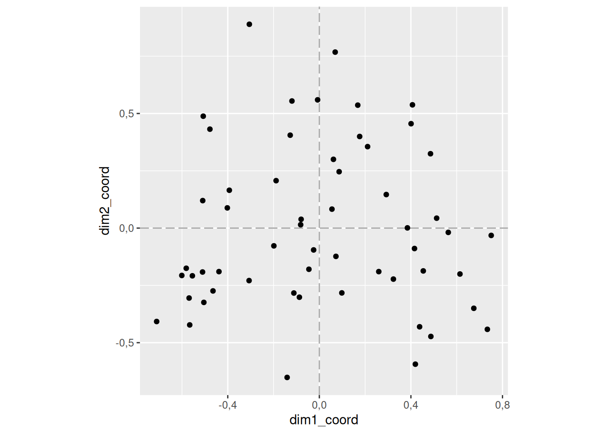
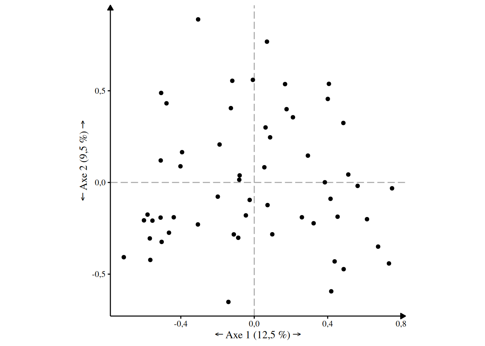
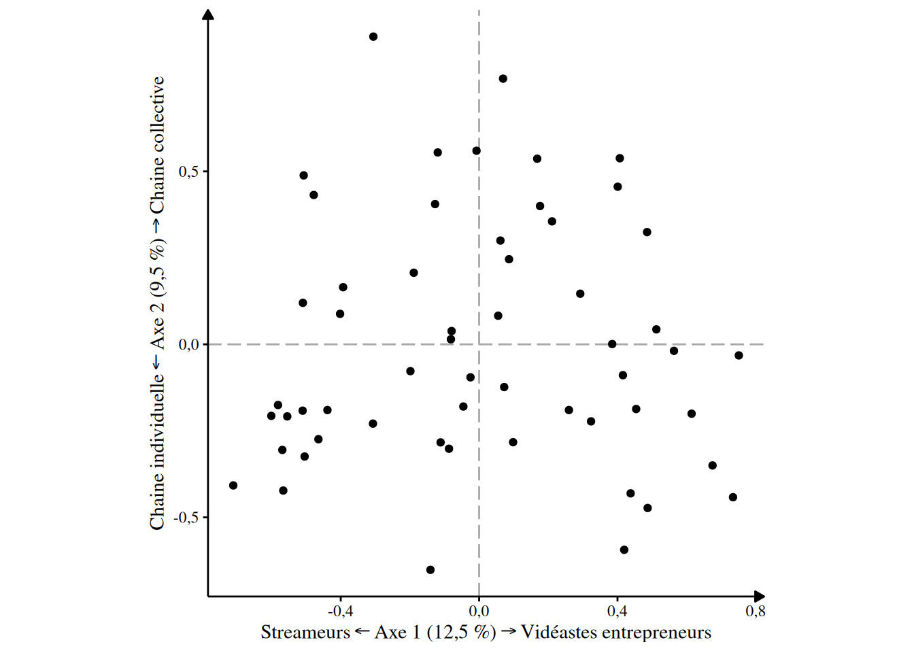
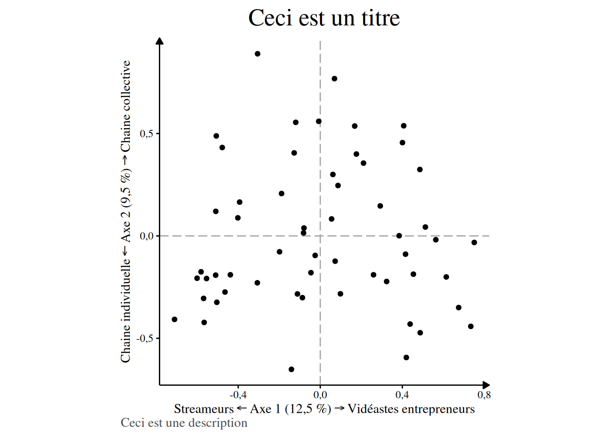

# Utilisation

``` r

library(ggacm)
```

Cette vignette de présentation montre comment utiliser le package.

Avant toute chose, il faut configurer la session R. En effet, certains
choix qui sont fait dans les options de R n’arrange pas beaucoup les
chercheurs en sciences sociales. la fonction mise_en_place() permet de
bien configurer R :

``` r

mise_en_place_ACM()
#> 
#> ── Les options générales de la session R ont été modifié.
#> ✔ Les nombres décimaux s'afficheront avec une virgule.
#> ✔ Ils n'afficheront que 3 chiffres après la virgule.
#> ✔ L'écriture scientifique a été désactivé.
#> 
#> 
#> ── Le thème des tableaux produit par gtsummary a été modifié. 
#> 
#> ✔ Ils s'afficheront en français.
#> ✔ En utilisant une virgule pour les nombres décimaux.
```

Une fois que cela est fait, on peut continuer. Commencez par charger vos
données dans R. Pour plus d’information sur comment faire, n’hésitez pas
à consulter des guides.

Une fois que vos données sont chargées, avant tout ACM vous allez
pouvoir les inspectez. Pour les besoins de la démonstration je prendrais
en exemple un jeu de données que j’ai créé pour mon mémoire de M2 sur
les créateurs de contenus politiques. Il est inclus avec le package et
est stocké dans un objet qui s’appelle `createurs_de_contenus_pol`.

``` r

createurs_de_contenus_pol 
#> # A tibble: 56 × 24
#>    personne  titre orientation orientation2 debut visage_decouvert abonnes genre
#>    <chr>     <chr> <fct>       <fct>        <fct> <fct>            <fct>   <fct>
#>  1 Antoine … Anto… De gauche   Progressiste 2015… Montre son visa… Entre … Homme
#>  2 Salomé S… BLAS… De gauche   Progressiste 2020… Montre son visa… Plus d… Femme
#>  3 Benjamin… Bolc… De gauche   Progressiste 2014… Montre son visa… Entre … Homme
#>  4 Aymric D… Cana… De gauche   Progressiste 2015… Montre son visa… Entre … Homme
#>  5 Cassandr… Cass… De gauche   Progressiste 2020… Montre son visa… 50k ab… Homme
#>  6 Pierre-Y… Cerc… De droite   Conservateur 2015… Montre son visa… Entre … Homme
#>  7 Christop… Chri… De droite   Conservateur 2014… Montre son visa… Entre … Homme
#>  8 Clément … Clém… De gauche   Progressiste 2020… Montre son visa… Entre … Homme
#>  9 Charléli… DANY… De gauche   Progressiste 2020… Montre son visa… Entre … Homme
#> 10 Julien G… Data… De gauche   Progressiste 2014… Ne montre pas s… Entre … Homme
#> # ℹ 46 more rows
#> # ℹ 16 more variables: age <fct>, streamer_plein_temps <fct>, collectif <fct>,
#> #   livre <fct>, podcast <fct>, twitter <fct>, facebook <fct>, instagram <fct>,
#> #   tiktok <fct>, discord <fct>, twitch <fct>, site_perso <fct>, CNC <fct>,
#> #   soutenir <fct>, partenariat_entreprise <fct>, autres_services <fct>
```

Ce jeu de données se composent de plusieurs colonnes :

…

Avant de procéder à l’ACM, il est vraiment utile de sortir un tri à plat
de toute sa base de donnée. Pour cela, on peut utiliser la fonction
[`tbl_summary()`](https://www.danieldsjoberg.com/gtsummary/reference/tbl_summary.html)
du package `gtsummary`. N’oubliez pas de retirer les variables qui ne se
prêterait pas un tri à plat (dans mon cas la variable personne et
titre). Vous pouvez retirez des variables en modifiant le paramètre
`include` comme je le fais plus bas.

``` r

createurs_de_contenus_pol |> 
  gtsummary::tbl_summary(
    include = c(-personne, -titre)
    # je retire la variable personne et la variable titre du tableau
  )
```

[TABLE]

Vérifiez bien toutes vos variables et vos modalités. Si une modalité
concerne moins de 10 % de votre population, cela peut causé des
problèmes pour la suite. Il faudra alors sûrement la recoder/la passée
en variable supplémentaire. Dans mon cas par exemple : ma base ne compte
que 2 écologiste, ce qui est trop peu. Je peux donc soit recoder la
variable `orientation` (comme je l’ai fait avec `orientation2`), soit la
mettre en variable supplémentaire lorsque je réaliserai l’ACM (c’est ce
que je vais faire).

Pour réaliser l’ACM, utilisez la fonction…
[`ACM()`](https://nicolasville.github.io/ggacm/reference/ACM.md)[^1].
Vous pouvez ensuite renseigner les variables à l’aide de l’argument
`variables_supplementaires`. Mettez-y les variables que vous ne
souhaitez pas voir participer à la construction des axes. Mettez-y
également les variables qui servent à identifier chacun de vos individus
(par exemple une variable `nom_prenom` ou dans mon cas, la variable
`personne` et `titre`).

Dans tbl_summary() vous vouliez inclure toutes les colonnes *sauf* les
colonnes titre et personne. Ici, ce sont ces colonnes que vous
sélectionnez comme variable supplémentaire, on ne met donc pas de moins
devant leur nom :

``` r
resultat_acm <- createurs_de_contenus_pol |> 
  ACM(
    variables_supplementaires = c(titre, 
                                  personne, 
                                  orientation,
                                  orientation2)
  )
#> ℹ Réalisation de l'ACM avec `FactoMineR::MCA()`
#> ✔ L'ACM a été réalisé avec succès avec `FactoMineR::MCA()` [39ms]
#> 
#> ℹ
#> • Sur 56 individus...
#> ℹ 
• et 24 variables.
#> ℹ 
#> ℹ 
── Variables actives : 20 
#> ℹ 
`debut`, `visage_decouvert`, `abonnes`, `genre`, `age`, `streamer_plein_temps`,
#> `collectif`, `livre`, `podcast`, `twitter`, `facebook`, `instagram`, `tiktok`,
#> `discord`, `twitch`, `site_perso`, `CNC`, `soutenir`, `partenariat_entreprise`,
#> and `autres_services`.
#> ℹ 
── Variables supplémentaires : 4 
#> ℹ 
`titre`, `personne`, `orientation`, and `orientation2`.[44ms]
```

Vous pouvez explorer les résultats de l’ACM avec la fonction du package
`explor` : `explor()` .

``` r

explor::explor(resultat_acm)
```

Si l’ACM vous convient, passez à la suite, sinon répétez les étapes
décrites plus haut jusqu’à ce que le résultat de l’ACM soit satisfaisant
pour vous.

Sur ces premiers graphiques, vérifiez que le nuage d’individu est bien
équilibré et ne se résume pas à une seule droite. Si c’est le cas, il
faut soit recoder votre base, soit penser à mettre les variables qui
posent problèmes en variable supplémentaires.

Les résultats de cette opération sont stocké dans un objet (que j’ai ici
appelé `resultat_acm`). Il contient tous les résultats de l’ACM. Mon
package propose une manière de sortir ces résultats afin qu’il soit prêt
à être publié. La plupart des fonctions présentés par la suite prendront
comme premier argument cet objet contenant les résultats pour extraire
ceux que vous souhaitez affichez.

## Les axes

La première chose que l’on souhaite en général savoir avec une ACM,
c’est le taux de variance capturé par les axes. Une idée assez répandu
voudrait qu’ils mesurent “l’information capturée” par chaque axe.

Pour afficher un tableau récapitulatif vous pouvez utiliser la fonction
[`extraire_variance()`](https://nicolasville.github.io/ggacm/reference/extraire_variance.md)
sur l’objet dans lequel vous stockez les résultat de l’ACM :

``` r

extraire_variance(resultat_acm)
#>    Axes Valeurs propres % de variance % cumulé de variance
#> 1 Axe 1            0,16        12,5 %               12,5 %
#> 2 Axe 2            0,12         9,5 %               21,9 %
#> 3 Axe 3            0,12         9,2 %               31,1 %
#> 4 Axe 4            0,09         7,2 %               38,4 %
#> 5 Axe 5            0,09         6,8 %               45,2 %
```

\[insérer un commentaire des résultats + la fonction pour obtenir la
variance modifié\]

Une fois que cela est fait, on veut souvent chercher à décrire les axes.
Pour cela, utilisez la fonction
[`caracteriser_axe()`](https://nicolasville.github.io/ggacm/reference/caracteriser_axe.md).
Précisez le numéro de l’axe que vous voulez caractérisé avec l’argument
`axe`.

Par défaut, vous ne souhaiterez peut-être pas afficher toutes les
modalités dans ce tableau (surtout si vous en avez beaucoup). L’argument
`contribution_minimum` permet de préciser un seuil de contribution
minimum pour filtrer les modalités. Par défaut, il se règle sur la
contribution théorique moyenne, c’est-à-dire la contribution de chaque
variable si elles contribuaient chacunes également à la construction des
axes.

Ainsi quand on lance la fonction sans préciser l’argument
`contribution_minimum` :

``` r

resultat_acm |> 
  caracteriser_axe(axe = 1)
#> Vous n'axez pas indiqué de contribution minimum pour afficher les résultats
#> Seules les modalités dont la contribution est supérieur à la moyenne théorique
#> seront affichées.
#> ℹ Si vous souhaitez modifier cela, vous pouvez changer l'argument
#>   contribution_minimum
#> → `contribution_minimum = 0` si vous souhaitez afficher toutes les modalités
#>   par exemple
#> 
#> 
#> ── Contribution moyenne théorique 
#> 
#> ℹ Si toutes les modalités actives contribuaient également à la construction
#> d'un axe, chacune aurait une contribution de 2,17 %.
```

| Modalité¹ | Contribution | Coordonnée² | Cos² | V-test | Effectif |
|----|----|----|----|----|----|
| Coordonnées positives |  |  |  |  |  |
| Vend ses produits | 9,3 % | 1,059 | 0,410 | 4,75 | 15 (27 %) |
| Sponsorisé.e par des entreprises | 8 % | 0,983 | 0,354 | 4,41 | 15 (27 %) |
| Site personnel | 4,7 % | 0,587 | 0,278 | 3,91 | 25 (45 %) |
| 2014 et avant | 3,7 % | 0,822 | 0,147 | 2,84 | 10 (18 %) |
| Pas de compte Twitch | 3,4 % | 0,528 | 0,180 | 3,15 | 22 (39 %) |
| Plus d'un million d'abonnés | 3,4 % | 1,107 | 0,120 | 2,57 | 5 (9 %) |
| Compte Facebook | 3,1 % | 0,460 | 0,197 | 3,29 | 27 (48 %) |
| Principalement youtuber | 3 % | 0,372 | 0,345 | 4,36 | 40 (71 %) |
| Ne demande pas de financement à l'audience | 2,9 % | 0,637 | 0,123 | 2,60 | 13 (23 %) |
| Pas de podcasts | 2,6 % | 0,475 | 0,136 | 2,73 | 21 (38 %) |
| Coordonnées négatives |  |  |  |  |  |
| 50k abonnés ou moins | 8,6 % | -1,018 | 0,379 | -4,57 | 15 (27 %) |
| Principalement streameur | 7,6 % | -0,929 | 0,345 | -4,36 | 16 (29 %) |
| Subvention du CNC | 3,8 % | -0,705 | 0,166 | -3,02 | 14 (25 %) |
| Pas de site personnel | 3,8 % | -0,473 | 0,278 | -3,91 | 31 (55 %) |
| Ne vend pas de produits | 3,4 % | -0,387 | 0,410 | -4,75 | 41 (73 %) |
| Pas de compte Facebook | 2,9 % | -0,428 | 0,197 | -3,29 | 29 (52 %) |
| Pas de sponsors d'entrerpises | 2,9 % | -0,360 | 0,354 | -4,41 | 41 (73 %) |
| 2020 et après | 2,4 % | -0,510 | 0,114 | -2,50 | 17 (30 %) |
| Compte Twitch | 2,2 % | -0,342 | 0,180 | -3,15 | 34 (61 %) |
| ¹ Seules les modalités actives dont la contribution est supérieure à 2,17 % sont représentées. |  |  |  |  |  |
| ² Moyenne des coordonnées des individus partageant la modalité |  |  |  |  |  |

Si cela ne vous convient et que vous préféreriez un tableau plus
synthétique ou plus exhaustif, vous pouvez changer ce seuil :

``` r

caracteriser_axe(resultat_acm, axe = 1, contribution_minimum = 4.5)
```

| Modalité¹ | Contribution | Coordonnée² | Cos² | V-test | Effectif |
|----|----|----|----|----|----|
| Coordonnées positives |  |  |  |  |  |
| Vend ses produits | 9,3 % | 1,059 | 0,410 | 4,75 | 15 (27 %) |
| Sponsorisé.e par des entreprises | 8 % | 0,983 | 0,354 | 4,41 | 15 (27 %) |
| Site personnel | 4,7 % | 0,587 | 0,278 | 3,91 | 25 (45 %) |
| Coordonnées négatives |  |  |  |  |  |
| 50k abonnés ou moins | 8,6 % | -1,018 | 0,379 | -4,57 | 15 (27 %) |
| Principalement streameur | 7,6 % | -0,929 | 0,345 | -4,36 | 16 (29 %) |
| ¹ Seules les modalités actives dont la contribution est supérieure à 4,5 % sont représentées. |  |  |  |  |  |
| ² Moyenne des coordonnées des individus partageant la modalité |  |  |  |  |  |

Pour caractériser l’axe 2, on peut copier et coller le même code en
changeant simplement le numéro de l’axe que l’on souhaite décrire :

``` r

caracteriser_axe(resultat_acm, axe = 2, contribution_minimum = 4.5)
```

| Modalité¹ | Contribution | Coordonnée² | Cos² | V-test | Effectif |
|----|----|----|----|----|----|
| Coordonnées positives |  |  |  |  |  |
| Chaîne collective | 10,7 % | 0,931 | 0,378 | 4,56 | 17 (30 %) |
| Ne montre pas son visage | 10 % | 1,854 | 0,264 | 3,81 | 4 (7 %) |
| Subvention du CNC | 6,4 % | 0,796 | 0,211 | 3,41 | 14 (25 %) |
| Compte Facebook | 5,9 % | 0,551 | 0,282 | 3,94 | 27 (48 %) |
| 40 à 44 ans | 5,1 % | 1,084 | 0,141 | 2,79 | 6 (11 %) |
| Coordonnées négatives |  |  |  |  |  |
| Vend ses produits | 6,1 % | -0,749 | 0,205 | -3,36 | 15 (27 %) |
| Pas de compte Facebook | 5,5 % | -0,513 | 0,282 | -3,94 | 29 (52 %) |
| Chaîne individuelle | 4,7 % | -0,406 | 0,378 | -4,56 | 39 (70 %) |
| Femme | 4,6 % | -0,894 | 0,133 | -2,71 | 8 (14 %) |
| ¹ Seules les modalités actives dont la contribution est supérieure à 4,5 % sont représentées. |  |  |  |  |  |
| ² Moyenne des coordonnées des individus partageant la modalité |  |  |  |  |  |

## Visualiser les résultats

Pour visualiser les résultats. Le plus simple restera toujours de faire
appel à explor::explor(). Les résultats ne sont cependant pas très joli
à mon goût. La section suivante s’adresse donc à

- Ceux qui souhaite avoir des visualisations de leur données plus
  esthétiques.

- Les utilisateurs avancés et moins avancés qui veulent avoir un plus
  grand contrôle sur les visualisations.

Toutes ces visualisations se basent sur le package ggplot. Jusqu’à
maintenant on utilisait directement les résultats de l’ACM pour sortir
nos tableaux. Ici, il va falloir les transformer un petit peu. Nous
allons donc créer deux objets, un premier objet resultat_individus qui
contiendra les coordonnées des individus ainsi que nos données initales
et un deuxième objet (que je nomme ici resultat_modalites) qui
répertorie les résultats par modalité. Pour extraire ces résultats du
résultat de l’ACM, on aura recours à la fonction
[`extraire_individus()`](https://nicolasville.github.io/ggacm/reference/extraire_individus.md)
et
[`extraire_modalites()`](https://nicolasville.github.io/ggacm/reference/extraire_modalites.md).

Pour extraire_modalites il suffit de faire passer le resultat de l’ACM à
la fonction :

``` r

resultat_modalites <- resultat_acm |> extraire_modalites()
resultat_modalites
#> # A tibble: 165 × 21
#>    type    variables modalites     n pourcentage dim1_coord dim1_cos2 dim1_vtest
#>    <chr>   <chr>     <chr>     <int>       <dbl>      <dbl>     <dbl>      <dbl>
#>  1 variab… debut     2014 et …    10        17.9    0.822   0.147         2.84  
#>  2 variab… debut     2015 - 2…    29        51.8    0.0156  0.000260      0.120 
#>  3 variab… debut     2020 et …    17        30.4   -0.510   0.114        -2.50  
#>  4 variab… visage_d… Montre s…    52        92.9   -0.00205 0.0000548    -0.0549
#>  5 variab… visage_d… Ne montr…     4         7.1    0.0267  0.0000548     0.0549
#>  6 variab… abonnes   50k abon…    15        26.8   -1.02    0.379        -4.57  
#>  7 variab… abonnes   Entre 50…    13        23.2    0.0896  0.00243       0.365 
#>  8 variab… abonnes   Entre 20…    23        41.1    0.373   0.0968        2.31  
#>  9 variab… abonnes   Plus d'u…     5         8.9    1.11    0.120         2.57  
#> 10 variab… genre     Femme         8        14.3   -0.597   0.0594       -1.81  
#> # ℹ 155 more rows
#> # ℹ 13 more variables: dim1_contrib <dbl>, dim2_coord <dbl>, dim2_cos2 <dbl>,
#> #   dim2_vtest <dbl>, dim2_contrib <dbl>, dim3_coord <dbl>, dim3_cos2 <dbl>,
#> #   dim3_vtest <dbl>, dim3_contrib <dbl>, dim4_coord <dbl>, dim4_cos2 <dbl>,
#> #   dim4_vtest <dbl>, dim4_contrib <dbl>
```

On obtient alors un tableau qui reprend pour chaque modalité et chaque
axe leur coordonnée, leur cos², leur vtest et leur contribution.

Pour `extraire_individu()` on peut procéder de la même manière:

``` r

resultat_individus <- resultat_acm |> extraire_individus()
resultat_individus
#> # A tibble: 56 × 39
#>    dim1_coord dim2_coord personne           titre orientation orientation2 debut
#>         <dbl>      <dbl> <chr>              <chr> <chr>       <chr>        <chr>
#>  1    -0.111     -0.283  Antoine Goya       Anto… De gauche   Progressiste 2015…
#>  2    -0.199     -0.0775 Salomé Saqué       BLAS… De gauche   Progressiste 2020…
#>  3     0.168      0.536  Benjamin Patinaud  Bolc… De gauche   Progressiste 2014…
#>  4     0.0551     0.0827 Aymric Dlavo       Cana… De gauche   Progressiste 2015…
#>  5    -0.510     -0.192  Cassandre Begous   Cass… De gauche   Progressiste 2020…
#>  6     0.211      0.355  Pierre-Yves Rouge… Cerc… De droite   Conservateur 2015…
#>  7     0.416     -0.0892 Christopher Lannes Chri… De droite   Conservateur 2014…
#>  8     0.0616     0.300  Clément Viktorovi… Clém… De gauche   Progressiste 2020…
#>  9    -0.478      0.432  Charlélie Jutan    DANY… De gauche   Progressiste 2020…
#> 10     0.0692     0.768  Julien Goetz       Data… De gauche   Progressiste 2014…
#> # ℹ 46 more rows
#> # ℹ 32 more variables: visage_decouvert <chr>, abonnes <chr>, genre <chr>,
#> #   age <chr>, streamer_plein_temps <chr>, collectif <chr>, livre <chr>,
#> #   podcast <chr>, twitter <chr>, facebook <chr>, instagram <chr>,
#> #   tiktok <chr>, discord <chr>, twitch <chr>, site_perso <chr>, CNC <chr>,
#> #   soutenir <chr>, partenariat_entreprise <chr>, autres_services <chr>,
#> #   dim3_coord <dbl>, dim4_coord <dbl>, dim5_coord <dbl>, dim1_contrib <dbl>, …
```

On retrouve donc le tableau de données que l’on a donné à manger à la
fonction ACM() qui a été augmenté de nouvelles colonnes avec notamment
les coordonnées des individus.

### Le nuage d’individu

Pour faire apparaître le nuage d’individu. Il suffit maintenant
d’utiliser les fonctions de ggplot, avec quelques subtilités cependant.
Pour ceux qui ne souhaitent pas s’embarrasser des subtilités[^2],
utilisez juste
[`ggacm()`](https://nicolasville.github.io/ggacm/reference/ggacm.md) à
la place vous gagnerez du temps.

``` r

library(ggplot2)
resultat_individus |> 
  ggacm() + 
  geom_point()
```



Il est possible d’améliorer ce graphique de plusieurs manières.
Premièrement en modifiant le thème de ggplot, pour qu’il soit plus joli.
Le thème
[`theme_acm()`](https://nicolasville.github.io/ggacm/reference/theme_acm.md)
qui vient avec le package illustre mes préférences personnelles.

``` r

resultat_individus |> 
  ggacm() + 
  geom_point() +
  theme_acm()
```


Pour éviter de toujours taper `+ theme_acm()`, je vous conseille d’en
faire le theme par défaut de votre session R. Cela restera le thème par
défaut jusqu’à ce que vous redémarriez R.

``` r

theme_set(theme_acm())
```

Ensuite, il est possible de nommer les axes. Pour cela, la fonction
[`nommer_axes()`](https://nicolasville.github.io/ggacm/reference/nommer_axes.md)
permet de définir des noms d’axes appropriés. Il suffit de la rajouter
au graphique. Elle prend comme premier argument le resultat entier de
l’ACM. Si on ne précise rien, les axes sont juste modifié de la manière
suivante

``` r

resultat_individus |> 
  ggacm() + 
  geom_point() + 
  nommer_axes(resultat_acm)
```



Vous pouvez précisez au bout des flèches pour aider à l’interprétation
du graphique. Pour cela, n’hésitez pas à vous aider des tableaux que
vous avez sortis avec caracteriser_axe(). Les modalités au coordonnées
négatives pour l’axe 1 sont à gauche, et celles qui sont positives à
droite. Pour l’axe 2, les coordonnées négatives sont en bas et les
coordonnées positives en haut. Dans mon cas, on peut donner les
interprétations suivantes :

``` r

resultat_individus |> 
  ggacm() + 
  geom_point() + 
  nommer_axes(resultat_acm,
              a_gauche = "Streameurs",
              a_droite = "Vidéastes entrepreneurs",
              en_bas = "Chaine individuelle",
              en_haut = "Chaine collective")
```


Ca fait beaucoup de choses à taper à chaque fois… n’hésitez donc pas à
stocker ces axes dans un objet pour y avoir recours plus facilement :

``` r

axes <- resultat_acm |> 
  nommer_axes(
    a_gauche = "Streameurs",
    a_droite = "Vidéastes entrepreneurs",
    en_bas = "Chaine individuelle",
    en_haut = "Chaine collective"
  )
```

Vous pouvez maintenant ressortir le graphique :

``` r

resultat_individus |> 
  ggacm() + 
  geom_point() + 
  axes
```



Enfin, peut-être souhaiteriez vous ajouter un titre ou une description ?
Dans ce cas-là, utilisez la fonction
[`labs()`](https://ggplot2.tidyverse.org/reference/labs.html) de ggplot.

``` r

resultat_individus |> 
  ggacm() + 
  geom_point() + 
  axes +
  labs(
    title = "Ceci est un titre",
    caption = "Ceci est une description"
  )
```



Si vous souhaitez aller plus loin. Vous pouvez par exemple consulter la
vignette dédié à la classification ascendante hiérarchie :
[`vignette("classification")`](https://nicolasville.github.io/ggacm/articles/classification.md).

[^1]: La fonction
    [`ACM()`](https://nicolasville.github.io/ggacm/reference/ACM.md) va
    exécuter sous le capot la fonction
    [`FactoMineR::MCA()`](https://rdrr.io/pkg/FactoMineR/man/MCA.html)
    du package `FactoMineR` qui va réaliser l’ACM. Si vous préféré vous
    pouvez utiliser cette dernière à la place, le résultat sera le même.

[^2]: ggacm est un raccourci pour
    `ggplot(aes(x = dim1_coord, y = dim2_coord)` qui en plus de cela
    fixe les coordonnées et rajoute un cadran. Pour plus de détails,
    voir `?ggacm()`.
