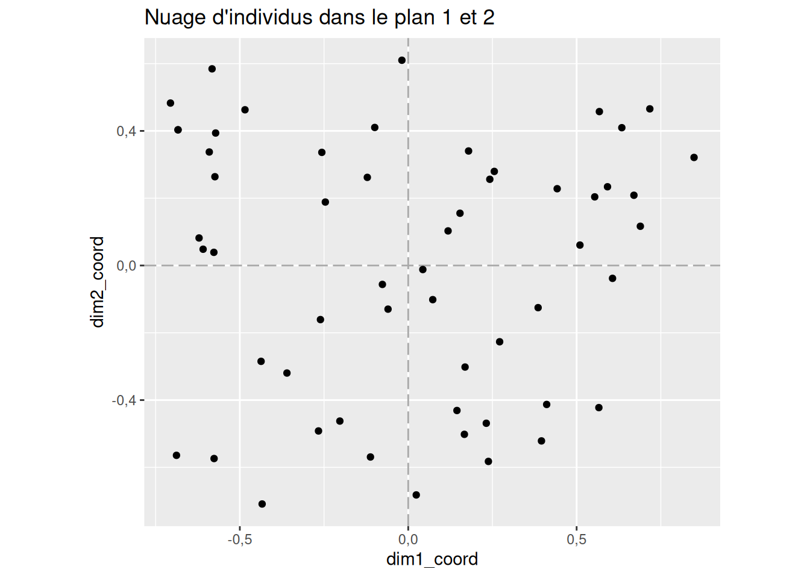
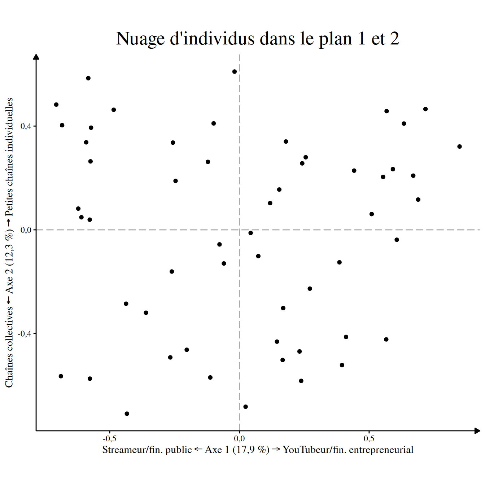
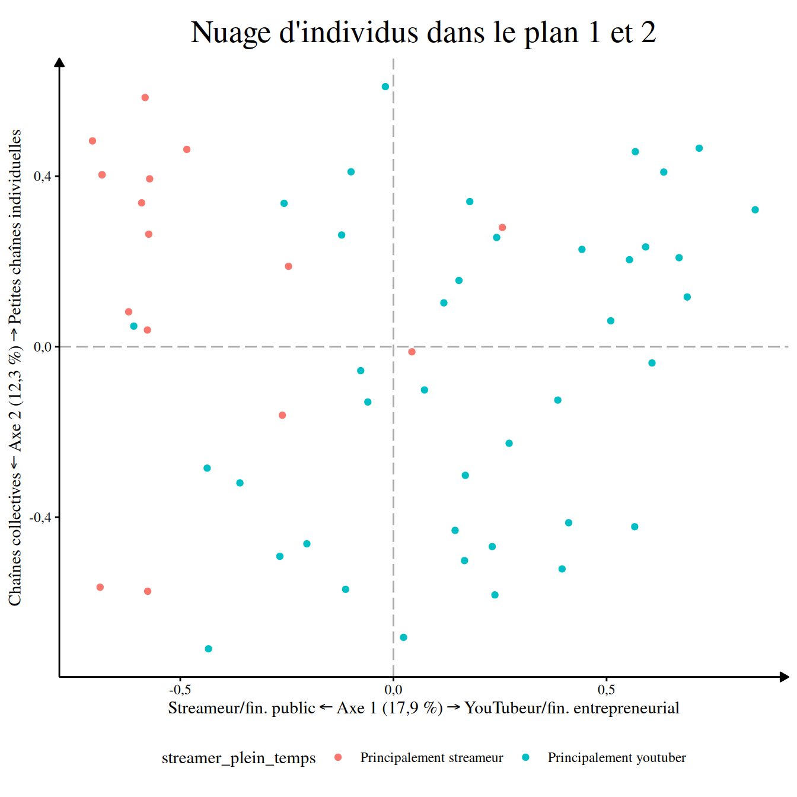

# ggacm

``` r

library(ggacm)
```

Cette page propose de vous montrer très rapidement comment utiliser le
pacage tout en vous orientant vers les pages correspondantes.

Si vous êtes chercheurs en sciences sociales, je vous recommande
grandement d’utiliser ce package au sein d’un document *Quarto* pour
permettre de générer un document qui compilera tous vos résultats. Ce
type de document permet de faire apparaître du code et son résultat
côte-côte, il vous évitera de devoir faire copier-coller et générera à
chaque fois que vous le lancerez vos tableaux. Pour vous familiarisez
rapidement avec ce type de document vous pouvez consulter [cette
page](https://benegarbi.github.io/PremiersPasAvec_quarto.html) de E.
Morand et B. Garnier.

Concrètement vous allez commencez par charger le package ainsi que les
packages du `tidyverse` et ceux de `gtsummary` qui seront
particulièrement utiles pour la suite :

``` r

library(ggacm)
library(ggplot2)
library(gtsummary)
```

Ensuite on mets à jour certaines options pour que les tableaux en
sorties nous conviennent avec `mise_en_place()` :

``` r

mise_en_place_ACM()
#> 
#> ── Les options générales de la session R ont été modifié.
#> ✔ Les nombres décimaux s'afficheront avec une virgule.
#> ✔ Ils n'afficheront que 3 chiffres après la virgule.
#> ✔ L'écriture scientifique a été désactivé.
#> 
#> 
#> ── Le thème des tableaux produit par gtsummary a été modifié. 
#> 
#> ✔ Ils s'afficheront en français.
#> ✔ En utilisant une virgule pour les nombres décimaux.
```

Puis vous chargerez vos données dans un objet avec un code qui ressemble
à cela :

``` r

createurs_de_contenus_pol <- readr::read_csv2("createurs_de_contenus_politiques.csv")
```

Pour plus de détails sur la marche à suivre et comment trouver comment
importer vos données, je vous renvoie vers la page dédié du
[guide](https://juba.github.io/tidyverse/07-import.html) de Julien
Barnier.

Sur cette page, j’utilise la base de données utilisées dans mon mémoire
qui vient avec le package et qui se nomme `createurs_de_contenus_pol`,
pour une description des variables, vous pouvez taper
`?createurs_de_contenus_pol` dans la console.

``` r

createurs_de_contenus_pol
#> # A tibble: 56 × 24
#>    personne  titre orientation orientation2 debut visage_decouvert abonnes genre
#>    <chr>     <chr> <fct>       <fct>        <fct> <fct>            <fct>   <fct>
#>  1 Antoine … Anto… De gauche   Progressiste 2015… Montre son visa… Entre … Homme
#>  2 Salomé S… BLAS… De gauche   Progressiste 2020… Montre son visa… Plus d… Femme
#>  3 Benjamin… Bolc… De gauche   Progressiste 2014… Montre son visa… Entre … Homme
#>  4 Aymric D… Cana… De gauche   Progressiste 2015… Montre son visa… Entre … Homme
#>  5 Cassandr… Cass… De gauche   Progressiste 2020… Montre son visa… 50k ab… Homme
#>  6 Pierre-Y… Cerc… De droite   Conservateur 2015… Montre son visa… Entre … Homme
#>  7 Christop… Chri… De droite   Conservateur 2014… Montre son visa… Entre … Homme
#>  8 Clément … Clém… De gauche   Progressiste 2020… Montre son visa… Entre … Homme
#>  9 Charléli… DANY… De gauche   Progressiste 2020… Montre son visa… Entre … Homme
#> 10 Julien G… Data… De gauche   Progressiste 2014… Ne montre pas s… Entre … Homme
#> # ℹ 46 more rows
#> # ℹ 16 more variables: age <fct>, streamer_plein_temps <fct>, collectif <fct>,
#> #   livre <fct>, podcast <fct>, twitter <fct>, facebook <fct>, instagram <fct>,
#> #   tiktok <fct>, discord <fct>, twitch <fct>, site_perso <fct>, CNC <fct>,
#> #   soutenir <fct>, partenariat_entreprise <fct>, autres_services <fct>
```

Une fois que cela est fait, je peux réaliser l’ACM en précisant les
variables supplémentaires.

``` r
resultat_acm <- createurs_de_contenus_pol |> 
  ACM(variables_supplementaires = c(titre, 
                                    personne, 
                                    orientation,
                                    orientation2,
                                    debut,
                                    twitter,
                                    genre, 
                                    age,
                                    visage_decouvert))
#> ℹ Réalisation de l'ACM avec `FactoMineR::MCA()`
#> ✔ L'ACM a été réalisé avec succès avec `FactoMineR::MCA()` [44ms]
#> 
#> ℹ
#> • Sur 56 individus...
#> ℹ 
• et 24 variables.
#> ℹ 
#> ℹ 
── Variables actives : 15 
#> ℹ 
`abonnes`, `streamer_plein_temps`, `collectif`, `livre`, `podcast`, `facebook`,
#> `instagram`, `tiktok`, `discord`, `twitch`, `site_perso`, `CNC`, `soutenir`,
#> `partenariat_entreprise`, and `autres_services`.
#> ℹ 
── Variables supplémentaires : 9 
#> ℹ 
`titre`, `personne`, `orientation`, `orientation2`, `debut`, `twitter`,
#> `genre`, `age`, and `visage_decouvert`.[48ms]
```

Une fois que cela est fait, on peut extraire un premier nuage de points
pour s’assurer qu’il a une forme adaptée

``` r

nuage_individus(resultat_acm)
```



On peut ensuite consulter la variance capturée de chaque axe :

``` r

extraire_variance(resultat_acm)
#>    Axes Valeurs propres % de variance % cumulé de variance
#> 1 Axe 1            0,20        17,9 %               17,9 %
#> 2 Axe 2            0,14        12,3 %               30,3 %
#> 3 Axe 3            0,12        10,8 %               41,1 %
#> 4 Axe 4            0,09         8,3 %               49,4 %
#> 5 Axe 5            0,08         7,4 %               56,7 %
```

Puis caractériser chaque axes. Pour l’axe 1 par exemple :

``` r

resultat_acm |> 
  caracteriser_axe(axe = 1, contribution_minimum = 4)
```

| Modalité¹ | Contribution | Coordonnée² | Cos² | V-test | Effectif |
|----|----|----|----|----|----|
| Coordonnées positives |  |  |  |  |  |
| Vend ses produits | 10,1 % | 1,074 | 0,422 | 4,82 | 15 (27 %) |
| Sponsorisé.e par des entreprises | 6,7 % | 0,872 | 0,278 | 3,91 | 15 (27 %) |
| Site personnel | 6,4 % | 0,662 | 0,353 | 4,41 | 25 (45 %) |
| Pas de compte Twitch | 5,4 % | 0,650 | 0,273 | 3,87 | 22 (39 %) |
| Principalement youtuber | 4,1 % | 0,418 | 0,438 | 4,91 | 40 (71 %) |
| Coordonnées négatives |  |  |  |  |  |
| Principalement streameur | 10,2 % | -1,046 | 0,438 | -4,91 | 16 (29 %) |
| 50k abonnés ou moins | 9,5 % | -1,042 | 0,397 | -4,67 | 15 (27 %) |
| Pas de site personnel | 5,2 % | -0,534 | 0,353 | -4,41 | 31 (55 %) |
| Subvention du CNC | 4,3 % | -0,720 | 0,173 | -3,08 | 14 (25 %) |
| ¹ Seules les modalités actives dont la contribution est supérieure à 4 % sont représentées. |  |  |  |  |  |
| ² Moyenne des coordonnées des individus partageant la modalité |  |  |  |  |  |

Et pour l’axe 2 :

``` r

resultat_acm |> 
  caracteriser_axe(axe = 2, contribution_minimum = 4)
```

| Modalité¹ | Contribution | Coordonnée² | Cos² | V-test | Effectif |
|----|----|----|----|----|----|
| Coordonnées positives |  |  |  |  |  |
| Chaîne individuelle | 9,6 % | 0,537 | 0,661 | 6,03 | 39 (70 %) |
| 50k abonnés ou moins | 7,5 % | 0,766 | 0,215 | 3,44 | 15 (27 %) |
| Vend ses produits | 6,7 % | 0,725 | 0,192 | 3,25 | 15 (27 %) |
| Ne demande pas de financement à l'audience | 5,5 % | 0,703 | 0,149 | 2,87 | 13 (23 %) |
| Pas de compte Instagram | 4,5 % | 0,768 | 0,113 | 2,49 | 9 (16 %) |
| Pas de subvention du CNC | 4,3 % | 0,345 | 0,357 | 4,43 | 42 (75 %) |
| Coordonnées négatives |  |  |  |  |  |
| Chaîne collective | 21,9 % | -1,231 | 0,661 | -6,03 | 17 (30 %) |
| Subvention du CNC | 12,8 % | -1,035 | 0,357 | -4,43 | 14 (25 %) |
| ¹ Seules les modalités actives dont la contribution est supérieure à 4 % sont représentées. |  |  |  |  |  |
| ² Moyenne des coordonnées des individus partageant la modalité |  |  |  |  |  |

Le premier axe semble séparer les créateurs qui se financent de manière
entrepreneuriale et qui produisent sur YouTube et de l’autre les
streameurs qui se reposent sur des subventions publiques (et les dons de
la communauté qui ne sont pas codé dans cette base). Le deuxième axe lui
semble, concerner une opposition entre des petites chaînes individuelles
et des chaînes collectives un peu plus grosses.

On peut donc reproduire le nuage des individus :

``` r

label_axes <- nommer_axes(
    resultat_acm,
    a_gauche = "Streameur/fin. public",
    a_droite = "YouTubeur/fin. entrepreneurial",
    en_haut = "Petites chaînes individuelles",
    en_bas = "Chaînes collectives"
  )

theme_set(theme_acm())


nuage_individus(resultat_acm) + 
  label_axes
```



On peut vérifier qu’on trouve les streameurs à gauche et les youtubeurs
à droite en colorant ce graphique :

``` r

nuage_individus(resultat_acm, couleur = streamer_plein_temps) + 
  label_axes
```


